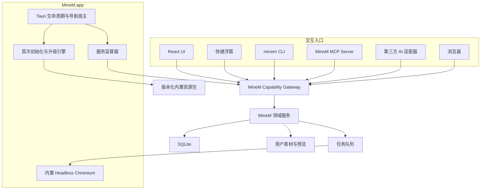

# MineM 本地 AI 客户端技术设计

> 文档状态：已确认，CLI v1 已实施，客户端能力网关分阶段实施中
> 目标版本：MineM vNext
> 更新日期：2026-07-19
> 关联文档：[本地 AI 客户端 PRD](MineM_LOCAL_AI_CLIENT_PRD.md)、[现有 macOS 客户端技术设计](macos-desktop-client.md)

## 1. 技术目标

构建一个可离线安装、自带运行环境、自动初始化、可安全升级的 macOS 客户端，并把 MineM 的业务能力通过统一能力网关提供给：

- MineM React 主界面。
- MineM 桌面快捷浮窗。
- MineM CLI。
- MineM MCP Server。
- WorkBuddy 类产品使用的本地 API 适配器。
- 浏览器访问和 `minem://` 深度链接。

所有入口必须复用同一业务服务，不允许各自直接写数据库或复制业务逻辑。

## 2. 当前基线与差距

| 范围 | 当前基线 | vNext 差距 |
| --- | --- | --- |
| 客户端 | Tauri 2 + macOS WebView | 缺少完整首次初始化与升级状态机 |
| 前端 | React 构建产物随客户端发布 | 继续复用，无需复制实现 |
| 后端 | `server.py` 与 `minem/` 通过 PyInstaller sidecar 打包 | 需要能力网关、鉴权、幂等和确认协议 |
| 快捷浮窗 | 已有菜单栏、全局快捷键和操作包复制 | 需要能力发现、结果回链与 AI 接入配置 |
| CLI | 已有可安装的 `minem` CLI、`minem.cli/v1` 输出协议、运行时发现、诊断、引用解析与正式编排能力 | 后续随能力网关补充认证和服务端幂等协议 |
| MCP | 尚未实现 | 需要新增本地 MCP Server，并复用能力网关 |
| 预览渲染 | `minem/thumbnails.py` 搜索系统 Chrome/Chromium | 需要随客户端打包固定渲染器，消除系统依赖 |
| 资源库 | 用户数据位于工作目录或 Application Support | 需要版本化内置资源包与用户资源覆盖层 |
| 升级 | `.app` 覆盖安装、用户目录保留 | 需要数据库迁移、资源包迁移、回滚和诊断 |

## 3. 目标架构



### 3.1 组件职责

- **Tauri 壳**：应用生命周期、窗口、标签、菜单栏、全局快捷键、深度链接和安全的原生命令。
- **Bootstrap Engine**：首次初始化、完整性校验、数据库迁移、内置资源导入和失败恢复。
- **Service Supervisor**：启动、发现、健康检查和回收 `minem-server`、MCP 与渲染进程。
- **Capability Gateway**：统一能力目录、参数校验、幂等、权限、确认、任务状态和审计。
- **Domain Services**：现有导入、汇报、页面、案例、资源、故事线、预览和导出逻辑。
- **Renderer Runtime**：固定版本的 Headless Chromium，仅负责截图、预览和需要浏览器渲染的导出。
- **Seed Pack Manager**：管理内置资源包版本、校验、导入与用户覆盖层。

## 4. 应用包与数据目录

### 4.1 应用包目标结构

```text
MineM.app/
  Contents/
    MacOS/
      MineM
      minem-server  # server / CLI / future MCP multi-call runtime
    Resources/
      frontend/
      templates/
      renderer/
      seed-packs/base-library-v1/
      manifests/
        runtime.json
        capabilities.json
        seed-packs.json
```

应用包内文件只读并参与签名。不得把用户数据库、上传文件、缩略图、导入绝对路径或私有材料写入 `.app`。

### 4.2 用户数据目录

```text
~/Library/Application Support/MineM/
  config/
    settings.json
    runtime.json
    ai-adapters.json
  data/
    minem.db
    backups/
  library/
    uploads/
    extracted/
    thumbnails/
    exports/
  packs/
    installed.json
  runtime/
    bootstrap-state.json
    service.json
    session.json
    session-token
    locks/
    staging/
  logs/
```

- 数据目录权限为当前用户可读写，不要求管理员权限。
- `session-token` 权限限制为当前用户，并在服务重启时轮换。
- `service.json` 只负责发现桌面托管服务；实际 Python 服务在 `session.json` 写入当前 `baseUrl` 与 PID。CLI 仅在端口匹配且 PID 存活时读取同目录 `session-token`。
- 临时文件先写入 `staging/`，验证成功后通过原子重命名发布。

## 5. 首次启动与恢复状态机

### 5.1 状态

```text
not_started
  -> verifying_bundle
  -> preparing_directories
  -> migrating_database
  -> installing_seed_pack
  -> validating_renderer
  -> validating_runtime
  -> ready
```

任一步骤失败进入 `failed`，记录 `failed_step`、错误码和可重试信息。再次启动从最近一个已提交步骤继续。

### 5.2 幂等规则

1. 每个步骤必须具有稳定步骤 ID、输入版本和完成校验。
2. 数据库迁移按迁移编号记录，重复执行不改变结果。
3. 内置资源按 `pack_id + stable_asset_id + content_hash` 导入。
4. 资源文件使用内容寻址或哈希索引，相同内容不重复复制。
5. 步骤在临时目录完成并校验后才写入完成标记。
6. `bootstrap-state.json` 只记录状态和版本，不记录用户素材内容。

### 5.3 启动锁

- 使用进程锁防止两个客户端同时初始化或迁移同一数据库。
- 仅复用同一数据目录、同一客户端版本且 `managedByClient=true` 的健康服务；不得自动复用 Docker、开发服务、旧版或其他 MineM 实例。
- `8790` 被任何其他进程占用时选择新的本机端口，不停止、不接管外部进程。
- 服务地址写入 `runtime/service.json`，CLI/MCP 通过该文件发现，不硬编码 `8790`。

## 6. 内置资源包

### 6.1 包结构

```text
base-library-v1/
  manifest.json
  assets.jsonl
  files/
  previews/
  templates/
```

`manifest.json` 至少包含：

- `pack_id`、`version`、`schema_version`。
- 文件清单、大小、SHA-256 和签名。
- 素材数量、素材类型和依赖闭包摘要。
- 最低 MineM 版本和数据库版本。

### 6.2 双层资源模型

- 内置素材：`origin=builtin`、`read_only=true`、带 `pack_id` 和稳定 ID。
- 用户素材：`origin=user`、可编辑、独立版本链。
- 修改内置素材时创建用户版本，通过 `derived_from` 指向原素材。
- 内置资源包更新只新增或升级内置版本，不重写用户版本与引用。
- 资源依赖必须形成闭包；HTML 引用的图片、视频、GIF、字体和脚本必须全部存在并通过校验。

## 7. 服务监督与本地安全

1. `minem-server` 仅监听 `127.0.0.1`，默认使用动态可用端口。
2. Tauri 启动服务时传入数据目录、端口、会话令牌位置和渲染器路径。
3. `/api/health` 返回应用版本、数据库版本、能力协议版本和就绪状态。
4. 网页 UI 使用受限会话；CLI、MCP 和第三方适配器使用独立本地访问令牌。
5. 写请求需要 `Origin` 校验、访问令牌和幂等键；不得仅依赖 localhost 作为信任边界。
6. 服务日志、令牌和诊断数据不得被静态文件服务暴露。
7. AI 请求访问应用数据目录之外的文件时，必须通过原生文件选择或明确授权。

## 8. 统一能力网关

### 8.1 设计原则

- UI、CLI、MCP 和第三方适配器调用同一能力实现。
- 能力名称与后端 HTTP 路径解耦，后端重构不破坏 AI 接入。
- 所有写操作先校验，再根据风险等级决定直接执行或等待确认。
- 耗时操作统一返回任务 ID，并通过状态查询或事件流获取进度。
- 所有成功结果返回 MineM 编号、版本与真实可访问链接。

### 8.2 能力命名

```text
system.health
system.capabilities
asset.search
asset.open
import.report
import.page
task.get
report.create
report.pages
report.page.insert
report.page.replace
report.page.modify
report.arrange
report.export
page.create
page.duplicate
page.modify
page.versions
case.extract
```

### 8.3 操作协议

```json
{
  "schema": "minem.operation.v1",
  "requestId": "req_...",
  "idempotencyKey": "idem_...",
  "source": "codex",
  "capability": "report.page.replace",
  "input": {
    "reportRef": "RPT-20260714-001",
    "targetPage": 6,
    "pageRefs": ["CTRL-PAGE-031"]
  },
  "requirements": "保留旧页面素材",
  "dryRun": true
}
```

统一响应：

```json
{
  "ok": true,
  "status": "awaiting_confirmation",
  "requestId": "req_...",
  "taskId": "task_...",
  "confirmation": {
    "required": true,
    "token": "confirm_...",
    "expiresAt": "2026-07-19T12:00:00+08:00"
  },
  "impact": {
    "reports": 1,
    "pagesAdded": 0,
    "pagesReplaced": 1,
    "oldVersionsPreserved": true
  }
}
```

### 8.4 幂等与任务状态

- 同一调用方、能力和幂等键返回同一逻辑结果。
- 失败重试不得创建新的素材记录，除非调用方提供新的幂等键。
- 状态统一为 `queued`、`validating`、`awaiting_confirmation`、`running`、`succeeded`、`failed`、`cancelled`。
- 编排、导入和导出成功必须以真实产物校验完成为准，不以数据库写入完成为准。

## 9. CLI 设计

### 9.1 安装与发现

- CLI 代码随 `minem-server` 一体多用运行时打包，避免重复携带 Python 环境。
- 客户端首次启动自动写入 `~/.local/bin/minem` 用户级启动器，无需管理员授权；升级与修复继续维护该入口，创作助手只复制稳定命令名 `minem`，不暴露本机绝对路径。
- CLI 从客户端专属 `runtime/service.json` 获取当前服务地址，再通过 `runtime/session.json` 校验实际端口与存活 PID，最后读取独立 `session-token`，不要求用户输入端口；显式 `--base-url` 或 `MINEM_BASE_URL` 连接其他实例时仍必须命中对应 session manifest 或显式提供 `MINEM_SESSION_TOKEN`。
- MineM 未运行时，CLI 使用 macOS `open -gj -a MineM` 后台唤起客户端并等待专属运行时清单就绪。

### 9.2 输出契约

- 默认输出人类可读摘要，`--json` 输出稳定 JSON。
- 成功退出码为 `0`；校验失败、待确认、执行失败和连接失败使用不同非零退出码。
- 高风险操作使用 `--dry-run` 预检；命令行中的 `--yes` 只适用于交互终端，AI 调用必须走客户端确认令牌。
- CLI 不直接读写 SQLite，不复制后端业务校验。

### 9.3 示例

```bash
minem report page replace RPT-20260714-001 \
  --target 6 \
  --page CTRL-PAGE-031 \
  --dry-run \
  --json
```

## 10. MCP Server 设计

- MCP Server 由应用 sidecar 或 `minem mcp serve` 启动，并优先复用同一多调用运行时。
- 工具定义由 `capabilities.json` 生成，参数 schema 与能力网关保持一致。
- MCP 工具不直接调用数据库，只调用本地能力网关。
- 首版资源可暴露 MineM 素材详情、任务状态和能力说明；不得暴露整个用户目录。
- 写工具先返回影响预览；需要确认时返回 `awaiting_confirmation` 和可打开的 `minem://confirm/{requestId}`。
- AI 不能通过 MCP 参数伪造确认结果。

建议首批 MCP 工具：

```text
minem_health
minem_search_assets
minem_import_report
minem_import_page
minem_create_report
minem_list_report_pages
minem_insert_report_pages
minem_replace_report_page
minem_create_page
minem_duplicate_page
minem_modify_page
minem_extract_case
minem_get_task
minem_open
```

## 11. 快捷浮窗与第三方 AI 适配

### 11.1 快捷浮窗

- 继续使用独立轻量 WebView，不加载主 React 列表和缩略图。
- UI 只展示汇报、页面和案例三组固定场景，不读取当前标签、剪贴板或手动输入。
- 默认动作是复制包含固定技能、最少追问和 MineM CLI 执行协议的完整 AI 指令。
- 首次成功初始化后自动显示一次；本地只写入引导标记，不保存业务草稿、模板或剪贴板历史。
- 后续优先由 `Option + Command + M` 唤醒，同时注册 `Control + Option + M` 规避 macOS 原生菜单或前台应用抢占；菜单栏入口为可见备用路径。快捷键总是展开右侧抽屉，失焦保持显示。
- 静态 WebView 必须启用 Tauri 全局 API，并仅暴露受限 command；`set_collapsed` 在 `340` 点抽屉与 `48` 点图标间切换，`hide` 完全隐藏。抽屉不启用 drag region。
- WebView 启动先进入 CLI 检查状态。用户级 CLI 缺失或不可执行时显示修复门禁，不初始化素材列表、不复制指令；修复后原地复检并切换为就绪状态。指令使用发现到的绝对 CLI 路径。
- `main.rs` 只装配插件和应用生命周期；Sidecar、导航、创作助手和原生桥接分别位于 `desktop_runtime`、`navigation`、`quick_actions`、`native_bridge`，避免窗口和 Shell 逻辑继续集中增长。
- 除菜单栏与全局快捷键外，`--assistant`、`--creator-assistant` 和 `minem://assistant` 可从外部调用；单实例回调只展开已有抽屉。
- 后续可提供“发送到已配置 AI”入口，但必须通过显式适配器，不模拟键盘或绕过系统权限。

### 11.1.1 macOS 图标打包

- 品牌源文件位于 `desktop/src-tauri/icons/icon-source.svg`，构建前生成标准 PNG 尺寸和 `icon.icns`。
- `tauri.conf.json` 必须显式声明应用图标，确保 `Info.plist` 包含 `CFBundleIconFile`，并将 `.icns` 写入应用包资源目录。
- Dock、Finder、应用切换器与菜单栏复用同一品牌语义；菜单栏允许使用模板渲染，但不得显示通用 WebView 占位图标。
- 发布验收必须解包检查 `Info.plist` 和图标资源，不能只检查源码中是否存在 `icon.png`。

### 11.2 AI 适配器

适配器只负责协议转换和启动方式，不实现 MineM 业务逻辑：

- Codex：优先加载固定 Skill 并使用 CLI 或 MCP；快捷浮窗提供标准场景指令。
- WorkBuddy 类产品：优先 MCP；不支持 MCP 时粘贴场景指令并执行 MineM CLI。
- 其他可执行命令的 AI：使用场景指令内嵌的完整协议，不依赖专有 Skill 机制。

适配器配置保存在本地，不随诊断包导出密钥。第三方 AI 凭证不进入 MineM 数据库。

## 12. 深度链接

建议协议：

```text
minem://open/report/RPT-20260714-001
minem://open/page/CTRL-PAGE-031
minem://open/task/task_123
minem://confirm/req_123
minem://launch
```

- `open` 和 `launch` 只导航或启动应用。
- `confirm` 打开 MineM 原生确认界面，用户确认后才提交令牌。
- 深度链接参数必须严格解析和转义，拒绝任意文件路径、脚本和外部 URL。
- 多次打开同一内容时复用或聚焦已有标签，避免无限创建窗口。

## 13. 预览与渲染运行时

当前预览代码会搜索系统 Chrome/Chromium，无法满足干净设备离线运行。vNext 采用固定版本 Headless Chromium 随应用发布：

1. 构建时写入版本、架构和 SHA-256。
2. 运行时只使用应用内渲染器，不搜索用户系统浏览器。
3. 渲染器只允许访问 MineM 本机服务和当前任务的资源闭包，默认禁用外部网络。
4. 缩略图、预览重建和 PDF 导出统一使用同一渲染版本。
5. 渲染失败返回资源缺失、页面脚本错误、超时或尺寸异常等结构化错误。
6. 渲染进程由任务队列限制并发，任务完成后回收，避免长期占用内存。

## 14. 数据库迁移与升级

### 14.1 版本

分别记录：

- `app_version`
- `runtime_version`
- `database_schema_version`
- `capability_protocol_version`
- `seed_pack_versions`

### 14.2 升级事务

1. 获取独占升级锁并停止写任务。
2. 校验新应用和资源清单。
3. 创建 SQLite 在线备份和配置快照。
4. 在事务中执行数据库迁移。
5. 在 staging 中安装或升级内置资源包。
6. 运行数据一致性、资源闭包和代表性预览校验。
7. 原子提交版本状态并恢复任务。
8. 失败时回滚数据库与资源包状态，保留诊断信息。

不得在应用启动路径中自动删除疑似重复或垃圾数据；数据治理只生成报告，写入修复需要独立确认。

## 15. 构建、签名与发布

### 15.1 构建流水线

1. 构建 React 前端和快捷浮窗。
2. 使用 PyInstaller 构建支持服务/CLI/未来 MCP 模式的 `minem-server` 一体多用运行时。
3. 下载或读取锁定版本的 Chromium，校验哈希和许可证。
4. 构建并签名内置资源包清单。
5. 构建 Tauri `.app`，签名所有可执行文件、框架和 sidecar。
6. 生成 `.dmg`，执行 Apple 公证和 stapling。
7. 在干净 macOS 账户执行离线冒烟测试。

### 15.2 架构策略

- Apple Silicon 与 Intel 优先生成独立安装包，降低单包体积和 sidecar 复杂度。
- 如后续提供 Universal 包，所有原生 sidecar、Chromium 和动态库必须同时支持双架构。
- 安装包大小由内置渲染器与资源包决定，首版记录并监控，不通过删除必要运行资源换取体积。

## 16. 性能与资源预算

| 指标 | 目标 |
| --- | --- |
| 已初始化冷启动到可操作界面 | 5 秒内，超时显示进度而非白屏 |
| 快捷浮窗显示 | 300 毫秒内 |
| CLI/MCP 健康检查 | 1 秒内 |
| 空闲状态额外内存 | 持续监控，渲染器不得常驻 |
| 初始化/升级 | 全程有进度，可中断恢复 |
| 耗时任务 | 异步执行，支持状态查询和取消 |

列表、缩略图和图谱等大数据不得在快捷浮窗或 MCP 能力发现阶段加载。

## 17. 日志、审计与诊断

- 客户端日志：启动、窗口、深度链接和服务监督。
- Bootstrap 日志：步骤、版本、耗时和失败原因。
- 能力审计：调用来源、能力、对象编号、风险等级、确认人、状态和结果编号。
- 后端日志：请求 ID、任务 ID、导入/渲染/导出错误。
- 诊断包默认脱敏，不包含令牌、素材正文、完整剪贴板、用户上传文件和外部 AI 凭证。

日志使用大小与保留时间轮转，避免 Application Support 无限增长。

## 18. 测试方案

### 18.1 自动测试

- Bootstrap 每一步的幂等、失败恢复和并发锁测试。
- 数据库迁移前进、回滚和旧版本兼容测试。
- 内置资源包哈希、依赖闭包、重复导入和覆盖层测试。
- 能力协议 schema、权限、幂等、确认令牌和错误码测试。
- CLI 与 MCP 对同一能力返回一致结果的契约测试。
- 深度链接解析和危险输入拒绝测试。
- 固定渲染器的尺寸、资源加载、截图和 PDF 测试。

### 18.2 干净设备验收

- 未安装 Python、Node、Docker、Chrome。
- 断网完成安装、初始化、导入、预览、页面创建和汇报导出。
- 初始化中断后恢复，不产生重复数据。
- 覆盖升级后用户素材、汇报编排和历史版本保留；创作助手场景来自当前客户端版本，不迁移旧表单草稿或模板。
- 从 Codex 通过 CLI 或 MCP 完成一次创建、插入和结果回链。
- 从不支持 MCP 的 AI 通过快捷操作包完成同一业务闭环。

## 19. 实施顺序

1. **协议冻结**：确认 PRD、能力名称、操作 schema、风险等级和首批 MCP 工具。
2. **Bootstrap**：实现目录、锁、状态机、迁移与内置资源包。
3. **运行时补齐**：打包固定 Chromium，统一服务发现和会话令牌。
4. **能力网关**：将现有 API 收敛为稳定能力层，增加幂等、预检、确认和审计。
5. **CLI 与 MCP**：升级 CLI，新增 MCP Server 和深度链接。
6. **客户端体验**：升级快捷浮窗、初始化 UI、确认中心和诊断入口。
7. **发布验收**：签名、公证、干净设备离线测试和升级回滚演练。

## 20. 实现前必须确认

1. 首版正式支持的 macOS 最低版本和 CPU 架构。
2. 内置资源包的内容白名单与分发授权。
3. MCP 首版的写操作范围及风险等级。
4. 后台常驻策略，以及关闭主窗口时 CLI/MCP 是否继续运行。
5. 本地 API 第三方适配器的授权和令牌撤销方式。

## 21. 当前实施状态

截至 2026-07-19，第一阶段已完成以下基础实现：

- 新增 Rust `BootstrapSession`，状态原子写入 `runtime/bootstrap-state.json`。
- 创建兼容现有服务的 `data/`、`uploads/`、`extracted/`、`thumbnails/`、`report-exports/`，并新增 `config/`、`packs/`、`runtime/` 与 `logs/`。
- 使用跨进程文件锁阻止两个客户端并发初始化同一数据目录。
- 优先使用 `8790`；端口已被 Docker、旧版 MineM 或任意其他进程占用时选择新的本机端口，绝不复用外部服务。
- 服务健康检查使用 `/api/version` 并验证 MineM 产品标识，不再把任意 HTTP 200 当成 MineM。
- 写入 `runtime/service.json`，记录实际 `baseUrl`、端口、PID、版本和托管状态。
- CLI 只自动读取 `managedByClient=true` 的客户端服务清单，也支持 `MINEM_BASE_URL` 和 `--base-url` 显式覆盖；未发现运行实例时自动后台唤起客户端。
- `minem-server` 采用一体多用打包：客户端启动时进入服务模式，`minem --cli` 进入命令行模式，避免重复打包 Python 运行时。
- `v0.5.0-alpha.12` 将 PyInstaller 从 onefile 改为 onedir，运行时安装在 `Contents/Resources/sidecar/`，消除每次冷启动的临时解压。
- Tauri 单实例插件在其他插件和初始化前注册；重复启动只激活现有窗口，不生成第二个 Sidecar。
- 主窗口先加载本地启动页，服务初始化在后台线程执行；健康检查成功后原窗口导航到动态服务地址。
- Sidecar 接收 `MINEM_PARENT_PID` 并监控父进程；正常退出由 Tauri 回收进程组，异常退出由服务端主动停止。
- 服务日志每次启动轮转为当前文件与 `.old`，避免长期追加和无限增长。
- 客户端首次启动自动生成 `~/.local/bin/minem`；菜单栏和“创作助手”提供同一用户级入口的修复能力，不再请求管理员授权写入 `/usr/local/bin`。启动器优先定位 `/Applications/MineM.app`，覆盖升级后自动使用新版运行时。
- 新安装包优先读取 `Contents/Resources/sidecar/minem-server`；旧版同级单文件路径只作为升级兼容回退。
- 本机服务标准输出与错误输出写入客户端日志目录，并按启动轮转。
- 打包 sidecar 在独立进程组内运行；客户端退出时终止整个进程组，避免 PyInstaller 工作进程残留并阻塞下一次冷启动。
- `v0.5.0-alpha.13` 将原生壳拆分为 `desktop_runtime`、`navigation`、`quick_actions` 和 `native_bridge`，主入口只负责装配。
- 创作助手使用 `340×480–520` 点右侧抽屉与 `48×48` 点收起图标；汇报、页面、案例以纯图标分组切换并保留无障碍名称，三组场景由统一注册表渲染，AI 指令使用稳定命令名 `minem`、固定 Skill 和可填写空白项，剪贴板写入完成后逐字回读。
- 单实例支持 `--assistant`、`--creator-assistant` 和 `minem://assistant`，供快捷工具和第三方 AI 唤起既有助手窗口。
- `v0.5.0-alpha.14` 增加覆盖升级接管：运行时只回收清单中 `managedByClient=true` 且进程组可验证的旧版 Sidecar，确认旧端口释放后再启动当前版本；外部服务保持隔离。
- 启动子进程退出或超时时读取轮转错误日志的末尾摘要并返回启动页，避免仅暴露无诊断价值的退出码。

尚未在第一阶段实现：固定 Chromium、资源包安装器、数据库迁移器、访问令牌、能力网关、MCP、深度链接与初始化进度 UI。这些能力继续按第 19 节顺序交付。
