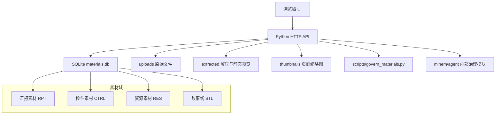
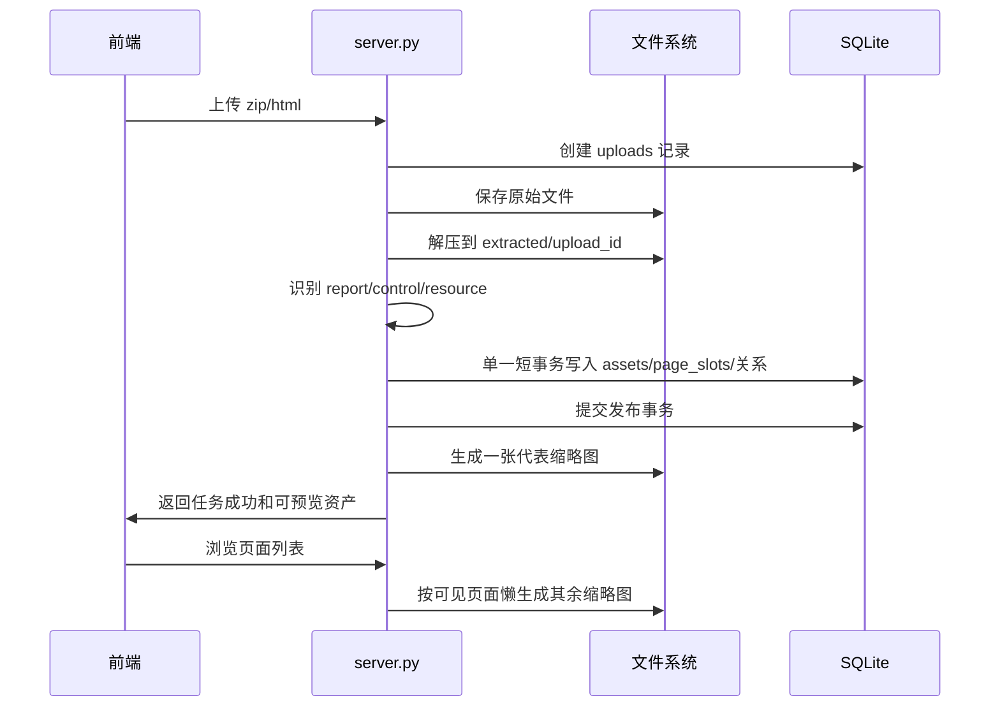

# MineM 技术文档

版本：0.5.0-beta.9 · 2026-08-21

## 1. 技术栈

- 前端：React + TypeScript + Vite，生产构建产物输出到 `public/`
- 后端：Python `ThreadingHTTPServer`
- 数据库：SQLite
- 文件存储：本地 `uploads/`、`extracted/`、`thumbnails/`
- 容器化：Docker Compose
- macOS 客户端：Tauri 2 + 系统 WebView；创作助手使用独立静态前端与官方全局快捷键插件

### 标签系统状态

- `assets.tags` 是已确认受控标签的兼容缓存；正式关系、来源、维度和证据保存在 `asset_tags`。`asset_history.tags` 与 `report_storyline_collections.tags` 不参与新标签写入。
- 类型、媒体、资源分类、编号、来源、版本、页槽位和编排继续使用各自的结构化字段，不能用标签替代。
- `GET /api/tag-taxonomy` 返回 `taxonomy-v1` 词表；`POST /api/assets/{id}/tags` 只接受词表内标签并记为 `manual`；`POST /api/ai-tag` 创建按类型执行的异步批量确认任务。
- P1 AI 标签建议按“人工确认 > 页面自身内容 > 汇报上下文 > 演讲稿/妙记/外部文档 > 结构化来源 > 文件名路径”聚合证据；每条候选需保存 `dimension`、`tag`、`confidence`、`evidence`、`priority`、`conflict_status`，冲突或低置信度不写入正式标签。
- 标签分析使用独立任务队列，与导入和同步服务分离。任务字段至少包括：`scope`、`trigger_type(manual|scheduled|retry)`、`status`、`content_fingerprint`、`model_version`、`taxonomy_version`、`progress`、`error`、`created_at`、`updated_at`。幂等键为“素材版本/内容指纹 + 模型版本 + 词表版本”；定时调度只选择待分析、内容变化或可重试失败项。
- 当前执行器为 `rules-v1`、词表为 `taxonomy-v1`：提取页面 HTML、元数据、汇报页槽和同批次业务上下文，写入 `asset_tag_evidence`，再生成 `asset_tag_suggestions`。普通和定时任务只更新候选；管理员显式 `apply_mode=confirmed` 时确认置信度不低于 `0.70` 的无冲突候选，写入 `asset_tags` 并同步 `assets.tags`，但不修改 `assets.updated_at`。
- `tag_definitions` 保存受控标签和维度；`asset_tag_suggestions` 以 `(asset_id, tag)` 幂等；`asset_tags` 以 `(asset_id, tag)` 幂等。资源素材会读取同一 `upload_id` 下页面和汇报的 P2 上下文，不以文件名作为高置信证据。

## 2. 系统架构



### 2.1 数据库迁移与任务运行时

- macOS 的 `scripts/start_local.py` 与 Tauri 客户端默认把 `MINEM_DATA_DIR` 解析为 `~/Library/Application Support/MineM/`，因此浏览器和客户端共享 SQLite、导入文件、派生页面、缩略图与导出产物。只有显式 `--data-dir` 才创建隔离运行库；若目标端口已有 MineM，启动器还需校验该端口对应目标运行目录的 `runtime/session.json`，不匹配时拒绝复用。
- SQLite Schema 使用 `schema_migrations` 记录已应用版本、名称、实现校验和与应用时间。`product-version.json` 的 `databaseSchemaVersion` 必须与代码迁移目标一致，否则服务拒绝启动。
- 现有无迁移记录的数据库先完成一次兼容整理，再登记 `legacy-schema-baseline`。后续已登记数据库不再重复执行旧兼容迁移。
- Schema 迁移使用数据库事务和迁移校验和，不在运行目录自动创建 SQLite 备份。需要迁移前快照时由用户在运行目录外显式执行，平台和数据治理脚本不得静默保留副本。
- 迁移使用 `BEGIN IMMEDIATE`；嵌套在测试或外部事务中时使用 Savepoint。任一迁移失败会回滚本轮所有 Schema 变更，已应用迁移的名称或校验和发生漂移时拒绝继续启动。
- 导入、导出、标签分析和缩略图统一进入进程内 `JobRuntime`。四类任务使用独立有界通道；导入、导出和标签各 1 个 Worker，缩略图 2 个 Worker，既限制 Chromium 并发，又避免列表缩略图长期排队。
- 相同通道与任务键重复提交时复用同一个 Future；队列达到容量后接口返回可重试的 `503`，并把已创建的持久化任务标记为失败，禁止永久停留在 `queued`。
- 服务重启后，遗留的导入、导出和标签 `queued/running` 任务统一转为带可操作原因的 `failed`；缩略图是可再生缓存，重新进入列表时按内容指纹再次排队。
- `/api/version` 在原有发布信息之外返回数据库迁移版本与各任务通道的 workers、容量、排队数、完成数和失败数；诊断信息不返回数据库备份绝对路径。

### 2.2 本地 API 会话与预览隔离

- 服务每次启动生成新的随机会话令牌，原子写入 `runtime/session-token`，文件权限固定为当前用户可读写的 `0600`；也可通过 `MINEM_SESSION_TOKEN` 显式提供。令牌不写数据库、日志、预览 URL 或素材 HTML。
- 生产管理首页只在字面回环 Host（`127.0.0.1`、`localhost`、`::1`）且客户端来自回环地址时注入会话令牌。React API 层自动为 `/api/*` 请求添加 `X-MineM-Session-Token`；CLI 先用桌面 `service.json` 发现服务，再校验同目录 `session.json` 的实际端口和存活 PID，匹配后才读取独立的 `session-token`。源码服务与 Vite 代理遵循同一绑定规则。
- 普通 `POST/PUT/PATCH/DELETE` API 必须通过会话令牌。浏览器请求还必须是当前服务的同源 `Origin`，`Sec-Fetch-Site` 不得为 cross-site/same-site；CLI 等非浏览器调用可以省略 Origin，但仍必须携带令牌。
- `GET /api/reports/{id}/trusted-entry` 为保留旧契约的显式重校验端点，会更新可信入口缓存，因此同样要求会话令牌和同源浏览器上下文；普通素材详情 GET 只读取已有缓存，不在读取时隐式写库。
- 所有请求校验 `Host`，默认只接受字面回环 Host，阻断 DNS rebinding。远程部署必须通过 `MINEM_ALLOWED_HOSTS` 显式列出服务域名；若允许远程浏览器执行写操作，还必须显式设置 `MINEM_ALLOW_REMOTE_SESSION=1` 和固定 `MINEM_SESSION_TOKEN`。否则远程页面不接收写令牌。
- 内部 Agent API 继续使用独立的 `MINEM_AGENT_API_TOKEN`；临时预览心跳和释放使用不可猜测的临时预览 token。三类令牌用途分离，不能互相替代。
- 平台生成的汇报、页面、案例和临时查看器属于受信任壳；真正的来源 HTML iframe 使用不包含 `allow-same-origin` 和顶层导航权限的 sandbox，并由响应头再次设置 CSP sandbox。来源脚本无法读取管理页令牌、持久化同源存储或直接导航顶层窗口；嵌入页使用页面级内存 Storage shim 保持依赖 `localStorage/sessionStorage` 的动效可运行。
- opaque-origin iframe 的相对 `fetch/XHR` 通过 10 分钟、仅限当前导入包的只读 capability 读取 `/extracted/` 静态依赖。capability 不适用于 `/api`、其他导入包或写请求，响应只对 `Origin: null` 返回 CORS，且服务日志统一脱敏。
- `/extracted/*.html` 的顶层访问统一进入平台查看壳；只有带 `embed=1` 的 iframe 请求返回来源 HTML。管理首页使用 CSP 限制脚本、连接、frame、form 和 frame ancestors，并设置 `Referrer-Policy: no-referrer`。

### 2.3 页面语义去重

- `databaseSchemaVersion=2` 为 `assets` 增加 `semantic_key`、`semantic_text_hash`、`semantic_fingerprint`、`semantic_fingerprint_version` 和 `semantic_dedupe_status`。迁移事务不改写原始页面、页槽和资源文件，也不在运行目录生成数据库副本。

### 2.4 编排与恢复一致性

- 编排确认在单个 SQLite 事务内重建页槽、保存顺序和隐藏状态、更新汇报公开入口并创建或复用 `1920×1080` 尺寸适配版本。尺寸包装文件通过文件变更日志参与失败回滚；事务提交后才进入缩略图队列。
- `extracted/` 按需恢复在发布前运行 `audit_dependency_closure()`，写入依赖审计结果；存在阻塞资源或汇报派生页同步异常时删除本次不完整恢复目录并返回失败。
- HTML 缩略图生成前检查当前入口的阻塞依赖。依赖缺失时不允许降级为文字图；内容指纹过期且源文件更新时删除旧图和元数据，等待真实浏览器重渲染。
- 列表业务活动时间通过三个聚合 CTE 计算版本、页槽和候选页最近活动，避免针对每条素材执行相关子查询。页数检测按文件路径、大小和纳秒修改时间缓存，文件更新会自动失效。
- 汇报公开页、编排查看器和编排接口共用已确认编排缓存。页面版本在同一个 SQLite 连接中批量解析；同一汇报的并发冷读取合并为一次构建。缓存键同时校验汇报、编排和页槽修订签名，素材写入沿用统一失效入口，因此接口写入和后台直接更新页槽都不会继续返回旧顺序。
- 页面语义指纹只取单页根节点中的唯一 `data-slide-key/data-page-key` 与去除脚本、样式、模板后的可见正文；标题、导入批次、HTML 外壳和资源绝对路径不能单独触发自动归并。正文不足 12 字或存在多个稳定 key 时不生成自动归并指纹。
- 新导入页面在发布事务提交后计算指纹。若命中其他主页面，仅定向生成候选和当前页面的最终缩略图；同时满足语义指纹一致、平均像素差不高于 `1.5` 且变化像素不超过 `3%` 时，才使用 `semantic-visual-v1` 收进同一版本链。
- 主版本按“汇报页槽引用数倒序、创建时间正序、编号正序”选择。归并只更新版本元数据，不迁移 `report_page_slots/report_page_candidates`，不删除页面记录、缩略图、来源文件或资源，因此不同汇报仍可追溯到各自导入的页面记录。
- 存量数据默认保持 `legacy`，不会因列表浏览自动变化。`scripts/audit_page_duplicates.py` 默认使用只读数据库连接输出 `auto-reuse/review` 清单；只有显式 `--apply` 才归并高置信组，并在提交前验证全部汇报页槽字节级一致。

## 3. 目录结构

```text
minem/
  frontend/                     # React + TypeScript 源码
    src/productLogic.ts         # 可测试的产品规则、排序与编号解析
    src/components/AssetPreview.tsx # 统一 HTML/媒体预览生命周期
  minem/                        # Python 领域模块
    agent/                      # 可选自动化能力，默认不开放 HTTP
    html_page_builder.py        # JSON 页面规范到自包含 1920×1080 HTML
  desktop/                      # macOS 客户端源码
  skills/minem-html-page/       # AI 生成并发布 HTML 页面素材的 Skill
  scripts/                      # 测试、校验、治理、版本与 CLI
  docs/                         # 产品和工程文档
  templates/                    # 运行时 HTML 模板
  public/                       # Vite 生成产物，不提交
  data/                         # SQLite 与本地状态，不提交
  uploads/                      # 原始上传，不提交
  extracted/                    # 入库素材与派生产物，不提交
  thumbnails/                   # 可再生缩略图，不提交
  report-exports/               # 导出产物，不提交
  server.py
  Dockerfile
  docker-compose.yml
```

说明：`frontend/` 是管理平台源码；`public/` 由构建任务生成并由后端静态托管。运行数据与源码分离，公开仓库和 CI 均以空素材库启动。`minem/agent/` 不进入前端导航，其 HTTP API 默认关闭。

### 3.1 HTML 页面构建器

`minem/html_page_builder.py` 读取 UTF-8 JSON 页面规范，对全部文本进行 HTML 转义，对布局、主题和颜色做白名单校验，并将本地 PNG、JPEG、WebP、GIF 或 SVG 编码为 data URI。输出不包含脚本、远程资源或查看器控件，画布固定为 1920×1080。

CLI `minem page build` 默认只写本地 HTML；使用 `--publish` 后继续调用既有上传接口和异步导入任务，不直接写 SQLite、`extracted/` 或缩略图目录。Agent 能力清单与 Schema 暴露 `page.build`，Skill 只负责组织 JSON 规范和调用 CLI，不建立第二套生成服务。

## 3.2 导入资源闭包

导入任务在解压或复制文件后、写入 `uploads` 和 `assets` 前执行 `minem/html_dependencies.py` 的只读递归审计。审计以 HTML 页面为入口，解析 `src`、`poster`、`data-fs-src`、`srcset`、样式表链接、内联 CSS `url()` 与 iframe；HTML/CSS 引用继续递归，直到本地依赖闭合。外部 URL、data URI、锚点和协议链接不纳入本地缺失判断。

审计不尝试以其他素材的同名文件替代缺失资源，避免错误内容被静默展示。发现缺失时任务在入库前失败，`extracted/{upload_id}/.minem-dependency-audit.json` 保留诊断；已存在历史包通过治理脚本检出并进入修复清单，不能再被误判为“预览正常”。

解压完成后、依赖闭包审计前增加 `normalize_ephemeral_runtime_references()`。该阶段只处理 HTML 标签中路径形态为 `/decks/<deck-id>/.runtime/<signed-token>/assets/<runtime-path>` 的临时 CSS/JavaScript：优先依据受控映射查找包内等价资源并改写相对路径；没有等价文件时移除对应 `link` 或 `script` 标签。处理结果写入 `.minem-import-normalization.json`，记录来源文件、原引用、动作和原因。该规则不得匹配图片、视频、音频、字体、iframe 或普通相对路径，也不得从其他历史批次借用同名文件。

### 导入事务与重建

所有 HTTP 上传、异步任务和自动扫描必须共用同一个导入编排器，禁止上传接口绕过依赖校验后直接调用目录扫描。导入编排器的阶段为 `received -> extracted -> normalized -> validated -> classified -> published -> preview-ready`；`published` 在单一短事务内写入正式 `assets`、`report_page_slots` 和资源关系，`preview-ready` 仅处理可再生缩略图缓存，不得持有数据库发布事务。

历史批次重建先输出引用清单和 dry-run，再在单一事务中更新数据库，并将旧批次派生目录移入任务级临时隔离区；成功后删除隔离区，失败则回滚事务并恢复目录。项目运行目录不创建 SQLite 副本。清理范围仅限 `upload_id` 对应的资产、候选页、页面槽、尺寸适配映射、缩略图和旧导入任务；重建读取原始 ZIP/HTML，生成新的批次 ID，避免旧 `_minem_pages`、`candidate-*`、`current-*`、`_minem_normalized` 再次参与源文件扫描。

HTTP 导入在依赖闭包通过后计算 `package-v1` 规范化指纹：按相对路径排序，并组合每个文件的字节内容。该指纹不受 ZIP 压缩参数和上传文件名影响。批次记录、素材、页槽和资源关系使用同一 SQLite 事务发布；页面完整性校验失败时整笔回滚。缩略图在事务提交后异步生成，不参与素材分类与正式数据提交。

汇报包写入器注入的 `copy_package_preview_thumbnail()` 在发布事务中必须保持无 I/O；事务提交后的 `generate_upload_thumbnails()` 只选择当前批次的代表素材，优先汇报、其次首张页面。其余页面由 `asset_thumbnail_url()` 写入既有单工作线程队列，按列表可见性懒生成，禁止为一个大包并行拉起大量 Chromium。

Chromium 单页渲染以截图文件稳定写入为完成信号，而不是等待浏览器主进程自然退出。渲染器轮询输出大小，连续稳定后终止独立进程组；12 秒仍无有效截图才失败。该机制避免 macOS Chrome 已写出图片但进程延迟退出时每页固定等待 24 秒。

`AUTO_IMPORT_ON_START` 默认值为 `0`；只有显式设置为 `1` 才允许启动扫描。普通 HTML 没有汇报 Manifest 或多页 Deck 结构时按页面素材处理。

导入工作线程属于当前服务进程，不能跨进程恢复。`init_db()` 完成 Schema 初始化后调用 `ImportTaskStore.recover_interrupted()`，将数据库中遗留的 `queued/running` 任务原子更新为 `failed`，进度置为 `100`，并写入可操作的中断原因。`POST /api/import-tasks/{id}/retry` 只允许重试已结束任务，校验私有 `stored_path` 仍位于当前运行目录的 `uploads/` 后，复用原 `task_id`、`upload_id` 和原文件重新启动完整导入编排；路径缺失或越界时拒绝重试。

React 任务浮窗只在 API 成功响应后覆盖后台状态。轮询失败进入独立 `connectionLost` 状态，保留最后数据但将进行中标签改为“连接中断”，每 2.5 秒有限请求一次恢复；连接成功后重新以服务端任务为准。该状态允许关闭卡片，不把网络异常写入共享数据库。

## 3.3 macOS 创作助手

创作助手由 `desktop/ui/quick-actions.html`、`quick-actions.js` 和 `quick-actions-core.mjs` 组成。UI 只维护汇报/页面/案例三组场景和复制状态；核心模块是唯一场景注册表，负责场景元数据、固定技能、对话采集项、执行协议和跨 AI 指令生成，可由 Node 内置测试独立验证。

Tauri 原生层使用 `tauri-plugin-global-shortcut` 注册 `Option + Command + M` 与备用键 `Control + Option + M`。透明助手窗口必须同时启用 `app.macOSPrivateApi` 与 Tauri `macos-private-api` feature，缺一即视为构建门禁失败。创作助手只使用剪贴板写入与本次写入的即时复核、CLI 路径发现与修复、右侧抽屉展开/收起和窗口隐藏命令，不调用 MineM 写 API，也不读取数据库、素材目录、剪贴板历史或其他应用浏览历史。详细交互与安全边界以 `docs/macos-desktop-client.md` 为准。

macOS 剪贴板写入直接使用 AppKit `NSPasteboard.generalPasteboard` 和 `NSPasteboardTypeString`，不再创建 `pbcopy`/`pbpaste` 子进程。原生层清空 Pasteboard、写入 `NSString`，随后从同一 Pasteboard 回读；比较前只统一 CRLF/CR 换行，不裁剪业务文本。写入返回值与完整内容校验同时通过才可返回成功。

前端在原生命令成功后再次调用 `clipboard_read` 复核；原生失败或超时时自动尝试 WebView Clipboard API/选择区回退，并对回退结果执行相同系统级复核。两层均失败才恢复入口并显示一个明确错误。平台头部通过 `POST /api/desktop/creator-assistant` 启动已安装客户端的 `--assistant` 单实例入口，不复制场景注册表。前端不接收业务参数，因此没有字段校验、草稿或模板状态；复制只校验场景存在、CLI 已就绪与系统剪贴板完整性。

`buildScenarioInstruction` 生成可直接填写的短自然语言指令，只包含动作、固定 Skill、2–3 个空白信息项、一个关键约束和完成结果要求。复杂分类、版本、幂等和验收协议由 Skill 维护；模板不包含 CLI 绝对路径、诊断命令或能力清单。AI 在后续对话中补全附件和引用并实际执行 CLI，浮窗不保存业务输入。

## 4. 数据模型

### 4.1 assets

核心资产表。

关键字段：
- `id`：内部主键
- `asset_code`：外部引用 ID
- `asset_type`：`report` / `control` / `resource`
- `category`：`report` / `page` / `proof` / `workflow` / `story` / `visual` / `code`
- `media_kind`：`html` / `image` / `video` / `gif` / `svg` / `none`
- `resource_kind`：`image` / `logo` / `icon` / `gif` / `video` / `svg`
- `upload_id`：来源批次
- `source_path`：批次内相对路径
- `preview_url`：预览路径
- `source_hash`：内容或来源哈希
- `version_group` / `version_no` / `version_parent_id`：相似图片版本组

### 4.2 uploads

导入批次表。

字段：
- `id`
- `filename`
- `stored_path`
- `extract_path`
- `file_count`
- `asset_count`
- `created_at`

### 4.3 report_page_slots

汇报页面槽位表，支持并行页面生成。

字段：
- `report_id`
- `page_number`
- `title`
- `status`
- `control_id`
- `task_key`
- `note`

### 4.4 report_page_arrangements

汇报编排元数据表，不改写来源 HTML。

字段：
- `report_id`：汇报素材 ID，唯一
- `page_order`：按当前展示顺序排列的页面素材 ID 数组
- `hidden_page_ids`：当前隐藏的页面素材 ID 数组
- `updated_at`：最后一次人工编排时间
- `updated_by`：操作来源，当前为 `manual-arrangement`

规则：
- 页面拖拽、隐藏、恢复仅更新前端会话内的编排状态；关闭弹窗即丢弃，服务端不保存草稿。
- 用户点击“确认编排”后，前端调用更新接口一次性提交 `page_order`、`hidden_page_ids` 和 `removed_page_ids`；服务端在单个事务内重建当前汇报的页面槽位、更新编排元数据和汇报活动时间。
- `GET` 编排接口和公开汇报入口保持只读，不执行尺寸转换、槽位重建或版本创建。尺寸适配只在启动迁移、导入发布或确认编排等显式写流程执行。
- 编排并发版本取 `report_page_arrangements.updated_at` 与当前汇报全部 `report_page_slots.updated_at` 的最大值；任何协作者或后台任务改变槽位后，旧会话提交必须返回冲突。
- 已存在编排记录时，`page_order` 中仍有效的页面构成正式顺序；额外槽位以 `pendingPageIds` 返回编排工作区，但不进入 `/reports/{id}/index.html`，直至下次确认。
- 前端以当前会话编排与服务端已确认编排的序列和隐藏集合比较，计算 `dirty` 状态；`dirty` 时关闭操作弹出保存确认，不调用接口前不得关闭主弹窗。
- 关闭确认提供保存、放弃、继续编辑三个结果：保存复用确认编排提交；放弃清空本地会话状态并关闭；继续编辑不改变任何状态。
- 编排主界面为独立前端路由，至少携带 `reportId`；详情预览的“编排”入口只负责导航，不再承载编排会话。
- 前端初始化必须解析 `?arrange=<reportId>` 并读取目标汇报后恢复编排工作区；深链不得依赖先从详情弹窗点击产生的内存状态。
- 页面素材选择器调用分页素材接口并固定 `type=control`、`include_versions=0`，使用已有缩略图；搜索、筛选和翻页不触发缩略图重建。
- 插入操作在前端会话中生成待提交的页面项。确认后服务端为新页面创建 `report_page_slots` 引用，再原子写入 `report_page_arrangements`；重复选择同一页面时按一次插入处理。
- 移出操作只允许移除当前汇报已有的槽位引用；确认后不删除 `assets`、资源文件或其他汇报槽位，页面素材仍可被检索和重新插入。服务端拒绝将汇报移为空页。
- 页面槽位 `page_number` 在确认时按最终顺序重新编号；已有槽位的 `control_id` 和来源文件均不改写。
- 汇报详情、独立预览、播放和导出读取编排元数据后组合页面；无编排记录时保持来源解析顺序。
- `/reports/{id}/index.html` 内嵌 `minem-arrangement-state` JSON，记录 `reportId`、`updatedAt`、`pageOrder` 和 `hiddenPageIds`。前端确认后必须解析并逐项比对该状态，不能仅检查响应状态码或编排查看器。
- 完整汇报导出使用已确认的 `report_page_slots` 与 `report_page_arrangements` 作为唯一输入，过滤 `hidden_page_ids` 和已移出槽位；导出服务不得读取前端未确认会话状态，也不得回写 `assets`、槽位、编排或来源 HTML。
- 编排表只引用既有 `report_page_slots.control_id`，不插入新的 `assets`、资源或来源 HTML 文件。
- 页面素材被重新同步后，读取时按现有页面槽位补齐新增页，并丢弃已不存在的引用。
- 独立页面公开入口为 `/pages/{controlId}/index.html`。直接访问来源 `/extracted/{uploadId}/{sourcePath}` 时，非嵌入请求重定向到该入口；嵌入请求携带 `embed=1`，继续返回来源 HTML 并注入统一等比适配样式，避免查看器嵌套。

### 4.5 report_export_tasks

完整汇报导出任务表与文件目录。导出是异步任务，不占用前端请求线程；任务状态为 `queued`、`running`、`completed`、`failed`，记录 `report_id`、格式、可见页数、进度、错误信息、输出路径、创建/更新时间。

- HTML 导出器调用 `report_public_page_items(report_id)` 获取已确认页面序列，以新建临时工作目录复制每页 HTML 与依赖资源，生成离线 Viewer 和 `minem-export-manifest.json`，最后写为 ZIP。
- HTML 导出器调用 `report_public_page_items(report_id)` 获取已确认页面序列，以新建工作目录递归收集每个页面 HTML、CSS、JS 中的本地依赖，生成离线 Viewer 和 `minem-export-manifest.json`，最后写为 ZIP。不得复制整个提取包；`ai-presenter`、TTS、语音模型、模型权重、语音文件和演讲稿路径均被硬性排除，即使被旧页面旁路引用也不进入成品。代码文件仅使用 ZIP 无损压缩，不进行语义改写；不设置导出文件体积上限。
- 二进制资源在 ZIP 中使用 `ZIP_STORED`：图片、视频、音频、GIF、SVG、字体、PDF 和未知二进制绝不重编码。页面资源仍使用其原始相对路径，缺失页面 HTML 必须导致任务失败。
- PDF 导出器以 Chromium 隔离上下文逐页加载平台嵌入预览壳，使用 10 秒虚拟时间等待字体、图片、视频首帧与动效定时器完成后截图，再合并为单个 PDF。任何页面截图失败或超时都会使任务失败，不生成不完整 PDF。
- 每页 PDF 输出使用汇报目标画布，最终合并为单个 PDF。导出临时目录、任务记录和成品放在运行数据目录 `report-exports/`，不提交 Git；不影响 `uploads/`、`extracted/`、`thumbnails/`。任务不回写素材、资源、页面槽或版本组。

### 4.6 asset_history

控件历史版本表。

触发场景：
- 同一页控件重新同步
- 单页导入覆盖已有控件

历史预览使用 `_history` 快照路径，避免当前版本覆盖历史版本。

### 4.7 report_storyline_collections

汇报收藏为故事线的持久化表。

字段：
- `id` / `code`：故事线内部 ID 与外部引用 ID，外部 ID 形如 `STL-YYYYMMDD-NNN`
- `source_report_id` / `source_report_code`：被收藏的来源汇报
- `output_report_id` / `output_report_code`：历史兼容字段；新收藏不再生成汇报资产，默认留空
- `target_report_id`：历史兼容字段；新收藏不再创建汇报版本，默认留空
- `mode`：新收藏写入 `collection`；历史数据可能存在 `new` 或 `version`
- `note` / `tags`
- `version_group` / `version_no` / `version_parent_id`：故事线自身版本组、版本号和父版本记录
- `created_at` / `updated_at`

收藏规则：
- 新增故事线只写入 `report_storyline_collections`，不插入 `assets`。
- 新建故事线时 `version_group = id`，`version_no = 1`。
- 更新已有故事线版本时，沿用目标故事线的 `version_group`，新增 `version_no + 1` 的记录，`version_parent_id` 指向被更新的故事线版本。
- 列表接口默认返回每个 `version_group` 的最新版本，并在 `versions` 中返回该故事线的完整版本历史。
- 不新增 `report` 资产，不创建汇报资产版本，不改变汇报列表数量。
- 来源汇报通过 `source_report_id` 关联；故事线详情可跳转查看来源汇报。
- 收藏动作不改写原始 HTML，也不改变生成素材的方式。

## 5. 编号规则

- 汇报素材：`RPT-YYYYMMDD-NNN`
- 来源汇报控件：`CTRL-{来源短码}-YYYYMMDD-页码`
- 无来源控件：`CTRL-PAGE-NNN`
- 无汇报 Manifest 的多页面资源导入：每个 HTML 入口按 `CTRL-PAGE-NNN` 独立入库，`source_type=control-resource-import`；不得创建推断型 `RPT` 资产。
- 案例多页面组使用 `CASE-*` 作为管理编号，案例组不是 `assets.report`，其内部页面仍为 `CTRL-*`。
- 图片资源：`RES-IMG-YYYYMMDD-NNN`
- 视频资源：`RES-VID-YYYYMMDD-NNN`
- GIF 资源：`RES-GIF-YYYYMMDD-NNN`
- SVG 资源：`RES-SVG-YYYYMMDD-NNN`

历史 `CTRL-MOCK-*` 会由治理脚本迁移为来源汇报编号。

## 6. API

| Method | Path | 说明 |
| --- | --- | --- |
| GET | `/api/assets` | 获取素材列表，支持 `type/category/resource_kind/control_role/q/include_versions/page/page_size` |
| GET | `/api/assets/{id}` | 获取素材详情 |
| GET | `/reports/{id}/index.html` | 汇报真实公开入口，按已确认的页面编排组合展示 |
| GET | `/api/reports/{id}/arrangement` | 获取汇报页面、缩略图和当前排序/隐藏状态 |
| POST | `/api/reports/{id}/arrangement` | 用户确认后提交汇报页面排序和隐藏状态，并更新真实公开入口 |
| DELETE | `/api/assets/{id}` | 删除素材 |

删除接口采用“引用校验 -> 记录保留页面 -> 关联数据清理 -> 主记录删除 -> 事务提交 -> 文件清理”的固定顺序。删除汇报时清理其页槽、编排、尺寸适配、候选页、导出任务、标签和故事线关联，但不删除被引用的页面或资源；保留页面原子更新为 `source_type=retained-report-page`，来源说明不得残留已删除汇报编号。删除页面时若仍被页槽、候选页或尺寸适配关系引用，返回 `409` 和引用汇报清单，不允许把引用改为空字符串。文件只在数据库事务成功后删除，事务失败不得出现记录仍在但预览文件已经丢失的状态。

案例删除由 `minem/case_deletion.py` 编排。服务先为 manifest 中全部主版本 `CTRL-*` 建立删除计划，并聚合页槽、候选页和尺寸适配引用；存在任一冲突时返回 `409`、`blockedPages` 和 `referenceCodes`，数据库保持不变。全部通过后，在一个 `BEGIN IMMEDIATE` 事务中删除案例页面及版本记录，提交后再清理页面文件和运行目录 manifest。资源素材与外部源 manifest 不参与删除。

无显式 Manifest 的 HTML Deck 使用 `extract_page_node_spans` 计算真实页面根。优先以 `.slide-frame` 顶层节点为页，不以同一页内层的 `data-slide` / `data-page` 组件或业务 iframe 数量推断页数；仅当来源本身是明确的 iframe 页面查看器时才允许 iframe 表示页面。真实页面根少于两个时进入单页页面素材扫描，不创建 `RPT`。

启动历史治理采用保守门禁：仅当 `source_type=report-material-sync`、存在且仅存在一个有效页面槽、入口检测结果严格等于一页时，才删除误生成的 `RPT` 外壳并保留其 `CTRL` 页面。零页槽、孤儿页槽、多页槽及非同步来源全部跳过，由数据审计报告处理；禁止根据一个 viewer 入口的 DOM 结构直接重分类正常汇报。

客户端删除流程不得调用 `window.confirm`。React 维护待删除素材和提交状态，平台内确认弹窗展示影响范围；确认后只发送一次 `DELETE /api/assets/{id}`，等待服务端事务成功再关闭详情并刷新列表。`409` 引用冲突和其他错误必须原位显示，不得静默关闭。
| GET | `/api/assets/{id}/export` | 导出控件模板包 |
| POST | `/api/reports/{id}/exports` | 创建完整汇报 HTML/PDF 导出任务，参数 `format: html|pdf` |
| GET | `/api/report-exports/{taskId}` | 查询导出任务状态、进度、失败页面与下载地址 |
| GET | `/api/report-exports/{taskId}/download` | 下载成功的导出文件 |
| GET | `/api/assets/{id}/history` | 获取控件历史 |
| GET | `/api/assets/{id}/versions` | 获取相似版本 |
| GET | `/api/assets/{id}/lineage` | 获取原数据链路详情，供双抽屉列表和详情使用 |
| POST | `/api/assets/{id}/tags` | 写入人工确认的受控业务标签，不接受自由文本 |
| POST | `/api/uploads` | 同步导入 zip |
| POST | `/api/import-tasks` | 创建异步导入任务，支持 HTML、ZIP、图片、SVG、GIF 和视频 |
| GET | `/api/import-tasks` | 获取最近导入任务 |
| GET | `/api/import-tasks/{id}` | 查询导入任务 |
| POST | `/api/import-tasks/{id}/retry` | 复用仍在本机上传目录中的原文件重试已失败或中断任务 |
| POST | `/api/auto-import` | 自动扫描本机素材 |
| POST | `/api/sync-report-materials` | 显式同步 extracted 中的汇报材料包 |
| POST | `/api/ai-tag` | 按素材类型创建高置信标签批量确认任务 |
| GET | `/api/tag-taxonomy` | 获取受控标签维度、标准词和版本 |
| GET | `/api/tag-analysis/tasks` | 获取标签任务列表 |
| POST | `/api/tag-analysis/tasks` | 创建候选或批量确认任务，支持 `scopeType` 与 `apply` |
| POST | `/api/merge-similar` | 合并相似图片 |
| GET | `/api/storylines` | 获取故事线模板与汇报收藏产生的故事线；收藏故事线按最新版本返回并包含版本历史 |
| GET | `/api/case-groups` | 从已导入案例 manifest 与真实 `CTRL-*` 主版本生成案例组；过滤未入库或无预览页面 |
| DELETE | `/api/case-groups/{code}` | 原子删除案例组及组内页面版本；被汇报引用时整体返回 `409`，资源和外部源文件保留 |
| GET | `/api/reports/{id}/pages` | 获取汇报页槽 |
| POST | `/api/reports/{id}/pages` | 创建或更新汇报页槽 |
| POST | `/api/reports/{id}/controls` | 将汇报页面导入为控件 |
| POST | `/api/reports/{id}/storyline-collections` | 将汇报新建为故事线或作为已有故事线的新版本 |
| GET | `/api/reports/{id}/trusted-entry` | 强制重新校验完整汇报入口文件并写回可信状态 |
| POST | `/api/report-page-candidates/{id}/adopt` | 采纳候选页面并同步到最新汇报 |

### 6.1 原数据链路接口

`GET /api/assets/{id}/lineage` 返回当前素材、来源批次、可信入口和可点击 section。

`GET /api/assets` 在数据库分页前计算 `activity_at` 并倒序排列。该值取素材自身更新时间、版本组最近更新时间；页面素材还合并 `report_page_slots` 与 `report_page_candidates` 的最近引用时间。前端只用 `activity_at` 做同页稳定排序，不重新改变跨页顺序。

核心结构：
- `asset`：当前素材摘要。
- `sourceBatch`：当前素材 `upload_id` 对应批次摘要。
- `trustedEntry`：完整汇报的入口校验结果，仅汇报素材一定存在。
- `sections`：前端原数据链路的可点击字段列表。

当前 section：
- `current-stage`：当前层级。
- `source-action`：生成动作。
- `source-batch`：原数据批次。
- `batch-output`：批次产物，按 report/page/control/resource 分组。
- `created-at`：入库时间。
- `resource-breakdown`：资源细分，按 `resource_kind` 分组。
- `source-path`：原始路径。

数据口径：
- 汇报数：同一 `upload_id` 下 `asset_type=report` 的资产数。
- 页面数：优先取完整汇报可信入口解析到的页面数，不等同于已拆出的控件数。
- 控件数：同一 `upload_id` 下 `asset_type=control` 的资产数。
- 资源数：同一 `upload_id` 下 `asset_type=resource` 的资产数。
- 资源细分：同一 `upload_id` 下资源资产按 `resource_kind` 聚合。

### 6.2 素材列表分页

`GET /api/assets` 在传入 `page` 或 `page_size` 时启用服务端分页；不传分页参数时保持旧行为，返回完整列表，兼容旧调用方。

请求参数：
- `page`：页码，从 1 开始。
- `page_size` / `limit`：每页数量，最大 200。
- `control_role`：控件素材的叙事角色筛选，取值如 `开场定位`、`背景价值`、`案例展开`，默认 `全部`。

返回结构：
- `assets`：当前页素材。
- `pagination.page`：当前页。
- `pagination.pageSize`：实际每页数量。
- `pagination.total`：符合筛选条件的总数。
- `pagination.totalPages`：总页数。
- `pagination.hasPrev` / `pagination.hasNext`：上一页/下一页状态。

前端当前主素材库使用 `page_size=30`，采用滚动加载下一批；工作台每类只拉取前 8 条作为概览样本。素材查询统一按最近业务活动时间倒序返回：汇报取编辑/更新，页面取编辑、版本或引用更新，资源取新增、编辑、复用或版本更新。该顺序由 `ASSET_ACTIVITY_SQL` 统一计算，API 和前端不得再次按标题或创建时间覆盖排序。

列表加载状态必须区分 `loading` 与 `empty`。请求开始时才显示加载提示；成功响应且 `assets=[]` 后立即进入空状态，停止加载动画，不因统计值为 `0` 重试请求。该逻辑位于共享 React 前端，浏览器、Docker 与 macOS WebView 使用同一实现。

### 6.3 外部资源导入

`POST /api/import-tasks` 支持资源素材页的“导入外部资源”入口。

支持格式：
- 汇报/素材包：`.html`、`.htm`、`.zip`
- 图片与矢量：`.png`、`.jpg`、`.jpeg`、`.webp`、`.svg`
- 动态与视频：`.gif`、`.mp4`、`.mov`、`.m4v`、`.webm`

处理口径：
- HTML 复制为该批次的 `index.html`，再由 `scan_upload()` 识别为汇报素材。
- ZIP 安全解压到 `extracted/import-*`，再扫描其中的汇报、控件和资源。
- 单个资源文件复制到 `extracted/import-*`，再扫描为资源素材。
- 该流程只做平台入库解析，不改变已有生成素材目录和生成方式。

## 7. 导入流程



## 8. 预览一致性

实现点：
- `row_to_asset()` 调用 `canonical_preview_url()`。

### 8.1 Preview Shell

- 新增前端统一预览壳组件，输入为页面 URL 列表、当前索引、页面标题和是否允许翻页；汇报、临时汇报、案例、编排后预览与独立预览均复用该组件。
- 完整汇报查看器初始化时只创建当前页 iframe；当前页完成后再预热前后邻页，最多保留三个 live iframe。切页时销毁距离当前页超过一页的 iframe，并清理对应计时器与过期加载回调。
- 导航不等待其他页面完成；单页超时或失败只影响该页并提供重新加载。来源页 iframe 默认只授予 `allow-scripts`，不得让隐藏或预热页面拥有 popup、modal、form 或 download 能力。列表卡片仍只加载缩略图。
- 汇报和页面平台查看器的外层预览容器固定为 `1920×1080` 逻辑画布，使用 `contain` 计算 iframe 显示区域；来源素材的 `preview_meta.width/height` 只用于裸来源 HTML、资源预览和尺寸版本生成，不能再次缩放统一查看器。`ResizeObserver` 驱动尺寸重算，避免轮询和重复加载。
- 对固定尺寸来源 HTML，Preview Shell 必须以检测到的来源逻辑画布宽高创建内层 viewport，并对该 viewport 应用单一 `transform: scale()`；不得只放大 iframe 外框，否则会产生左上角内容和大面积空白。来源比例为 16:9 时缩放后应填满标准容器。
- 无法可靠检测逻辑画布时，预览壳以 iframe 文档根节点的 `scrollWidth/scrollHeight` 与 `getBoundingClientRect()` 进行一次性握手测量；测量失败回退 16:9，并记录预览诊断结果供数据走查。
- 汇报页槽写入前执行 `report_canvas_normalize`：目标逻辑画布固定为 `1920×1080`。来源页面尺寸不一致时生成新的 `control` 资产版本和派生 HTML，而不是在查看器中强行拉伸；派生版本成为当前展示版本，原始版本保留在同一版本链中，并记录目标汇报、目标画布、来源版本和生成指纹。
- 同一来源版本、同一目标画布、同一派生策略的适配结果必须幂等复用，避免重复导入或重复编排生成多个等价版本。汇报槽只引用适配后的版本；原页面素材、其资源、历史链接和其他汇报的引用不得被改写或删除。
- 页码胶囊、全屏、复制当前页链接、刷新均为外层控件。Preview Shell 固定输出 `.fullscreen-page` 图标按钮，使用 Fullscreen API 对 `document.documentElement` 进入或退出全屏，并在 `fullscreenchange` 时同步按钮的标题和 `aria-label`；不得提供平台放大/缩小、滚轮缩放或画布拖拽；刷新只重载当前 iframe，复制使用当前页的真实预览 URL。
- 键盘事件仅在预览壳获得焦点时响应，避免干扰素材库搜索与弹窗输入框。
- 嵌入预览统一携带 `embed=1` 标记。服务端不得向带该标记的来源页注入复制/刷新工具；Preview Shell 是唯一的工具栏渲染者。
- 故事线来源汇报同样读取统一编排查看器并携带 `embed=1`，避免故事线弹窗内出现第二套页面工具。
- `report_canvas.py` 生成的尺寸包装页以包装文件为基准计算源页面相对 URL。该 URL 必须同时支持 HTTP `/extracted/...` 托管和 Chromium `file://` 缩略图截图；启动归一化会修复当前页槽及历史 `report_page_normalizations` 记录中的旧绝对地址，并为改写文件重新排队生成缩略图。
- 外部多页 HTML 由 `generated_external_report_page_items()` 拆分时，先通过 `detect_preview_dimensions()` 识别原生逻辑画布并生成忠实的来源页；发布阶段再为非标准来源页生成 `1920×1080` 当前版本。同一汇报的拆分页共享一个来源画布基准，且平台查看器只缩放标准版本一次。
- 生成页的 `<base href>` 使用生成页目录到原汇报入口目录的真实相对路径计算，并对 URL 路径段编码；禁止使用 `../../` 等固定层级。导入发布前递归验证生成页的 CSS、JavaScript、图片、字体、视频和 iframe 资源闭包。
- 实时公开页保留来源内容动效，不注入全局 `animation: none` 或 `transition: none`；仅将当前根页面设置为可见。缩略图渲染使用 `prefers-reduced-motion` 与足够的虚拟时间等待最终状态，两条链路互不改写来源 HTML。
- `generate_html_thumbnail()` 优先且唯一使用可用的 Chromium 读取当前 HTML；只有环境完全没有 Chromium 时才允许系统 HTML 渲染器参与，素材包内的 `preview.png`、`cover.png` 等缓存图片永不参与。Chromium 使用独立临时 profile 和固定 device scale；macOS 中即使进程延迟退出，只要截图已经完整写入也按图片质量继续校验。输出必须同时通过低方差、正文亮区、“等比内嵌画布”黑边三项门禁；仅有背景渐变、动画正文尚未出现、裁切或二次缩放的结果一律删除并重试，不能写入成功指纹。已有页面创建汇报时，`register_created_report_pages()` 直接将 `source_control_id` 写入页槽；汇报缩略图从当前第一页实时生成并绑定稳定公开入口指纹。
- 缩略图元数据 `THUMBNAIL_META_VERSION=4`；指纹必须包含当前 HTML 路径、大小和修改时间。API 不允许仅凭旧图片时间较新就补写新指纹。存量和未来当前版本均以 `1920×1080` 为平台标准，历史原版仅在版本链中保留。
- 对可识别的来源内置导航，嵌入层在不改写源文件的前提下添加隔离样式，隐藏常见的页码、上一页/下一页、轮播和全屏控制节点；多页来源由解析结果拆成平台页面序列，统一由 Preview Shell 切换 iframe URL。
- “打开链接”由资产预览路由处理，返回 Preview Shell；原始 `/extracted/...` 地址只作为嵌入和原始文件访问地址，不在平台操作中直接作为用户预览入口。
- 如果 `upload_id/source_path` 对应文件存在，API 返回真实路径。
- 如果历史版本 `preview_url` 指向 `/extracted/_history/`，保持历史快照。
- 治理脚本的 `normalize_preview_urls()` 会修复 DB 中错位的 preview。

前端使用：
- 卡片：`thumbnail_url` 优先，缺失时才惰性加载 `preview_url`；案例组 API 返回首个真实页面的 `thumbnailUrl`，列表不得用多页汇报 iframe 作为常规预览。
- 详情：直接使用 `preview_url`
- 打开链接：直接使用同一条资产的 `preview_url`

## 9. Logo 治理

治理逻辑：
1. 从来源路径和标题中识别企业名。
2. 对 PPT 图片编号建立映射，如 `s6-logo-136.png -> 长鑫存储（CXMT）`。
3. 对 `nio/jifeng/hailiang/pengfei/feishu` 等关键词直接命名。
4. 无法可靠识别时生成稳定中文标题，例如 `先进制造企业标识 140`。
5. 自动补充 `企业logo/客户logo/品牌标识/可直接使用` 等标签。

## 10. React 前端弹窗与抽屉

详情弹窗由 `frontend/src/App.tsx` 中的 React 组件渲染。当前稳定能力：
- 顶部操作区固定高频操作：打开预览、复制链接、复制 ID、删除。
- 相似版本区和并行页面生成区仍保持隐藏，避免干扰主素材管理流程。
- 原数据链路点击后调用 `/api/assets/{id}/lineage`。
- 双抽屉在详情弹窗内展开：左侧展示关联数据列表，右侧展示选中项详情和预览。
- 标签编辑、资源筛选、分页和导入任务浮窗均使用 React state 管理。导入任务关闭状态以设备级 `localStorage` 保存任务 ID 与关闭时间水位线；不写入共享服务端，避免一个用户关闭任务影响其他组织成员。服务断线使用独立 UI 状态并持续重连，服务重启后的遗留任务由后端统一标记中断。

注意：
- API 请求统一走 `frontend/src/api.ts`，不要在组件中散落 `fetch()`。
- URL 字段需通过 `absoluteUrl()` 或后端 canonical preview 口径收敛，后续应增加 URL 白名单校验。
- 前端文案默认由 React 转义；如未来引入 `dangerouslySetInnerHTML`，必须单独做白名单和净化。
- 继续拆分时优先把 `AssetModal`、`LineageDrawer` 拆成独立组件文件；`ImportDialog` 已迁入 `components/ImportWidgets.tsx`。

## 11. 数据治理脚本

命令：

```bash
python3 scripts/govern_materials.py
```

治理范围：
- 时间戳秒转毫秒
- 汇报标题去重
- report/control 分类归一
- 旧控件编号迁移
- Logo 标题清洗
- 预览路径校验
- 控件版本修复
- 孤儿关系删除
- 历史表 asset_code 同步
- 上传批次数量重算

## 12. Docker

启动：

```bash
docker compose up -d --build
```

访问：

```text
http://127.0.0.1:8790/
```

Docker 镜像使用 Node 构建阶段从 `frontend/` 生成生产前端，最终 Python 镜像不复制本机 `public/`。SQLite journal mode 由 `SQLITE_JOURNAL_MODE` 控制；数据、上传、解析、缩略图和导出目录通过 volume 持久化，容器重建不会丢失数据。

公开版 Compose 默认不挂载外部素材源，并设置 `AUTO_IMPORT_ON_START=0`。用户需要自动扫描时，必须复制 `docker-compose.override.example.yml` 并显式配置只读来源。平台与可选 TTS 服务仅绑定 `127.0.0.1`；TTS 使用独立 `speech` profile，模型权重不随仓库分发。内部 Agent API 默认关闭，需要时必须显式设置开关和随机令牌。

`uploads.stored_path` 与 `uploads.extract_path` 对平台自有文件使用运行目录相对路径，外部来源才保留外部绝对路径。上传包使用 `content_hash` 做幂等判断；相同内容再次上传时复用已有批次和预览。

上传安全配置：
- `MAX_UPLOAD_BYTES`：单个上传文件最大字节数，当前 compose 为 512MB。
- `MAX_UPLOAD_REQUEST_BYTES`：HTTP 请求体最大字节数，默认比单文件多 16MB 用于 multipart 开销。
- `MAX_ZIP_FILES`：压缩包最大文件数，当前 compose 为 5000。
- `MAX_ZIP_MEMBER_BYTES`：压缩包内单文件最大字节数，默认 256MB。
- `MAX_ZIP_TOTAL_BYTES`：压缩包解压后总量，当前 compose 为 1GB。
- `MAX_ZIP_COMPRESSION_RATIO`：压缩比异常阈值，默认 120。

## 12.1 公开运行边界

- 本机一键启动器负责创建 `.venv`、安装锁定依赖、构建前端并启动仅监听本机的服务。
- Docker 构建从源码生成前端，不依赖或复制开发机生成的 `public/`。
- CI 使用临时 `MINEM_DATA_DIR` 验证空素材库 API，不读取开发机数据库。
- GitHub 发布只使用 `public-release.json` 定义的源码边界，并对导出目录执行严格检查。
- 运行数据、外部导入源、模型、安装包和内部 Git 历史均不进入公开源码快照。

## 12.2 历史架构审查记录

截至 2026-07-18，代码规模：
- `server.py`：6,419 行；图谱 API 与领域模块已删除，仍集中 HTTP 路由、治理和部分汇报编排逻辑，是下一轮后端拆分重点。
- `minem/`：领域模块承接数据库、导入、HTML 拆页、汇报写库、案例真实清单、资源、标签、版本、资产分页、链路、缩略图和上传安全；新增 `case_groups.py` 后，案例不再依赖前端静态数据。
- `frontend/src/App.tsx`：2,146 行；主界面已删除无业务内容的设置页，案例、工作台和导入任务 UI 已拆至 `components/`，其余列表、详情和编排继续分批拆分。
- `frontend/src/components/`：当前包含 `CaseControlLibrary.tsx`、`Workbench.tsx`、`ImportWidgets.tsx`。
- `frontend/src/api.ts`：统一 API 请求和预览 URL 处理。
- `frontend/src/styles.css`：2,658 行，仍需按组件域拆分。

第一阶段已完成：
- 新增 `minem/config.py`，集中管理上传和解压安全配置。
- 新增 `minem/upload_safety.py`，统一限制上传文件大小、zip 文件数量、单文件大小、解压后总量、压缩比、路径穿越和符号链接。
- 新增 `minem/import_tasks.py`，将导入任务从进程内存迁移到 SQLite `import_tasks` 表。
- `GET /api/assets` 和 `GET /api/stats` 不再触发同步写入；同步改为显式 `POST /api/sync-report-materials`。

第二阶段已完成：
- `/api/assets` 支持服务端分页和控件角色服务端筛选。
- 前端素材库按页加载，筛选、搜索、切换类型时回到第一页。
- 工作台汇报、控件、资源概览只取每类前 8 条，避免进入工作台时全量拉取。
- 新增 `scripts/check_api_contract.py`，检查核心 API、分页结构、导入任务结构、链路接口和读接口无写入副作用。

第三阶段已完成：
- 新增 `minem/assets.py`，承接素材列表查询、筛选、分页和响应结构组装。
- 新增 `minem/lineage.py`，承接批次摘要、sourceBatch 注入、原数据链路详情和 pipeline summary。
- 新增 `minem/reports.py`，承接页码解析、候选页注册、页槽挂载和页槽读取。
- `server.py` 保留兼容包装函数和 HTTP 路由，领域逻辑继续从主服务文件迁出。
- `server.py` 从约 4749 行降至约 4421 行，第一批领域拆分减少了主文件职责密度。

第四阶段已完成：
- 新增 `minem/thumbnails.py`，承接 HTML 预览缩略图生成、比例裁剪、低方差兜底、文本缩略图和批次缩略图生成逻辑。
- `server.py` 对缩略图只保留依赖注入包装，缩略图模块可独立编译和后续测试。

第五阶段已完成：
- 新增 `minem/db.py`，承接 SQLite 连接、目录初始化、核心建表、资产表轻量迁移、索引创建和兼容迁移。
- `server.py` 的 `db()`、`ensure_schema()`、`init_db()` 改为薄包装，业务回填函数通过参数注入到数据库初始化流程。
- `SQLITE_JOURNAL_MODE` 在数据库模块中做白名单归一，避免环境变量直接拼接成不受控 PRAGMA。
- `server.py` 从 4397 行降至 4271 行，建表脚本不再内联在主服务文件里。

第六阶段第一轮已完成：
- 新增 `minem/imports.py`，承接导入任务存取包装、导入源配置读取、候选文件遍历、异步导入任务执行、自动扫描导入、直接文件导入和 zip 导入编排。
- `server.py` 保留原函数名作为兼容入口，通过依赖注入调用导入模块，HTTP 路由和后台线程调用方式不变。
- 自动导入模块测试使用临时目录和临时 SQLite 验证，不写入真实素材库。
- `server.py` 从 4271 行降至 4159 行，导入扫描编排已从主服务迁出。

第六阶段第二轮已完成：
- 新增 `minem/html_splitter.py`，承接 HTML 页节点识别、控件页抽取、汇报页替换、viewer pages 同步、页数检测和控件 HTML 构建。
- 新增 `minem/report_package_importer.py`，承接汇报包 manifest 识别、汇报入口定位、页面清单解析、候选页副本路径和汇报包目录发现。
- `server.py` 保留同名兼容包装，通过依赖注入复用 `read_json_file`、`merge_tags`、`slugify` 等本地规则。
- `server.py` 从 4159 行降至 3890 行，汇报包识别和 HTML 拆页基础逻辑已从主服务迁出。

第六阶段第三轮已完成：
- 新增 `minem/resource_importer.py`，承接素材包内 `assets/` 资源入库、资源类型识别后的标签合并、Logo 命名治理和资源 upsert。
- 新增 `minem/report_package_writer.py`，承接完整 report package 同步写库，包括汇报素材 upsert、控件候选版本写入、页槽挂载、缩略图触发、资源同步和上传批次计数更新。
- `server.py` 保留 `sync_report_package_resources()`、`sync_report_material_package()` 作为兼容包装，通过依赖注入复用现有编号、版本、页槽和缩略图规则。
- 临时 SQLite + 临时素材包模块测试验证可同步出 report/control/resource 各 1 条，不写入真实素材库。
- `server.py` 从 3890 行降至 3694 行，导入流水线写库逻辑已从主服务迁出。

第六阶段第四轮已完成：
- 新增 `minem/tagging.py`，承接标签拆分/合并、标签角色清洗、自动标签推断、资源类型判断、Logo 企业名识别和稳定中文命名。
- 新增 `minem/similarity.py`，承接图片 dHash、SVG 归一化哈希、相似资源特征采集、版本组计算和版本组写库。
- `server.py` 保留原函数名作为兼容包装，统一注入 `TAG_RULES`、资源标签白名单、Logo 企业映射、PIL 图片对象和素材路径解析函数。
- `server.py` 从 3694 行降至 3270 行，标签治理和相似版本计算已从主服务迁出。

第七阶段已完成：
- 新增 React + TypeScript + Vite 工程，源码位于 `frontend/`，构建产物输出到 `public/` 供 Python 后端托管。
- 新增 `frontend/src/api.ts`，统一 API 请求、错误处理和预览链接绝对化。
- 新增 `frontend/src/types.ts`，沉淀素材、分页、链路、导入任务等前后端契约类型。
- 新增 `frontend/src/App.tsx`，承接 App Shell、工作台、素材列表、详情弹窗、双抽屉、故事线和导入任务浮窗。
- 新增 `frontend/src/styles.css`，将外部设计规范落为 MineM 语义 token、顶部导航、卡片、弹窗和抽屉样式。
- `public/` 不再作为手写源码目录，只保存 Vite 生产构建产物。

整体重构阶段：
- 阶段 1：上传与导入安全、导入任务持久化、读接口去副作用。
- 阶段 2：素材列表服务端分页、工作台轻量加载、API 契约脚本。
- 阶段 3：抽离资产列表、原数据链路、汇报页槽领域模块。
- 阶段 4：抽离缩略图生成模块。
- 阶段 5：抽离数据库连接、建表、迁移和初始化基础设施。
- 阶段 6：抽离后端领域逻辑，包括扫描、zip/html 解析、汇报包识别、控件拆页、资源抽取、标签治理和相似版本计算。当前已完成导入流水线写库、标签治理和相似版本计算迁移。
- 阶段 7：前端 React 化和设计规范落地，统一 API、类型、状态、弹窗、双抽屉和导入任务视图。当前已完成 React 生产构建并由后端托管。
- 阶段 8：质量体系，补充导入/链路一致性测试，接入 Docker healthcheck 或发布前检查。

剩余风险：
- `server.py` 约 8,959 行，HTTP 路由、导入编排、汇报读取缓存和兼容包装仍然集中；需继续拆为请求处理、汇报查询、导入编排和运行数据治理模块。
- `App.tsx` 约 2,919 行，素材列表、详情、故事线和编排状态仍较集中；已有 `AssetPreview`、案例、导入和工作台组件，但还需继续拆分列表与详情域。
- `styles.css` 约 3,160 行，后续按 token、布局、素材、弹窗和编排拆分，并保持单一入口导入。
- CI 已覆盖文档、版本、公开边界、Python、前端、桌面交互、空库 API 与 CLI；真实素材全量预览仍需在本机发布门禁执行，不能上传客户数据到公开 CI。

建议拆分：
- 后端：继续拆为 `governance.py`、`http_handlers.py`，并逐步清理 `server.py` 中的兼容包装函数。
- 前端：继续拆为 `components/AssetGrid.tsx`、`components/AssetModal.tsx`、`components/LineageDrawer.tsx`、`components/ImportDialog.tsx`。
- 样式：按组件拆为 `tokens.css`、`layout.css`、`assets.css`、`modal.css`、`lineage.css`，继续由 `frontend/src/styles.css` 统一入口导入。

下一阶段整改优先级：
- P0：为显式同步和导入任务增加失败重试/取消。
- P1：原数据链路与详情预览的数据一致性测试；把契约脚本纳入发布检查。
- P2：继续拆 `governance.py` 和 `http_handlers.py`；统一弹窗/抽屉组件；URL 安全白名单。

## 13. 汇报模式

- `minem/presenter_mode.py` 独立渲染电脑控制台与投影页面，避免继续把大段页面模板写入 `server.py`。
- `/reports/{report_id}/presenter.html` 提供电脑端控制台；`/reports/{report_id}/audience.html` 提供投影端纯净页面。
- 两个入口都读取 `report_public_page_items()`，因此页序、隐藏页、页面版本和公开汇报入口保持同源；不另存汇报副本，也不改编排数据。
- `BroadcastChannel(minem-presenter:{report_id})` 负责同源窗口实时同步，`localStorage` 作为新开窗口和短暂断连的状态恢复通道。
- 页面内容继续通过 `/pages/{control_id}/index.html?embed=1` 的统一查看壳加载；投影端加载当前页真实 HTML，控制台当前页与底部页带使用已有缩略图缓存，不预加载下一页交互页面。
- 演讲稿沿用现有 `ai-presenter.html` 中 `defaultSpeakerNotes` 数据；映射顺序为页面 ID/编号、标题/来源、等长页序兜底。没有讲稿时返回空提示，不跨汇报复用。
- `POST /api/reports/{report_id}/presenter-notes` 按已确认编排中的稳定页面 ID 更新单页提示词，受本机会话令牌和同源写保护；单页上限 20000 字符。接口只替换 `defaultSpeakerNotes` 对应键，保留其他页提示词和演讲稿元数据。
- 控制台右栏只提供可滚动提示词编辑器，不展示下一页预览；草稿按页面保存在当前窗口内，显式保存成功后才更新页面数据，存在未保存草稿时拦截窗口关闭。
- `GET /api/reports/{report_id}/presenter-script` 返回 `presenterModeUrl`；详情页“汇报模式”和 AI 演讲台“进入演讲台”均进入平台统一控制台。

## 14. 验证清单

每次发布前执行：

```bash
python3 -m compileall -q minem scripts server.py
npm run check
python3 scripts/check_repository_docs.py
python3 scripts/check_public_boundary.py
python3 scripts/version_control.py check
python3 scripts/test_html_dependencies.py
python3 scripts/test_import_pipeline.py
python3 scripts/test_report_canvas_normalization.py
docker compose build
docker compose up -d
python3 scripts/check_api_contract.py --base-url http://127.0.0.1:8790
curl -s http://127.0.0.1:8790/api/stats
```

浏览器验证：
- 首页无乱码图标
- MineM 品牌标识显示为 M
- 汇报卡片预览正常
- 控件卡片预览正常
- 资源 Logo 标题不显示导入中间文件名
- 详情弹窗内容与卡片预览对应同一资产
- 详情顶部可复制真实预览链接
- 原数据链路字段点击后出现双抽屉，左侧列表和右侧详情可联动
- `/api/narratives` 不作为正式 API 保留
