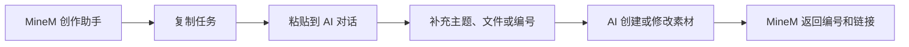

# MineM 用户使用说明 / User Guide

MineM 是一套本地优先的汇报素材平台。它帮助你创建、导入、整理和复用完整汇报、
单独页面、案例与图片等资源。你既可以在平台里直接操作，也可以让 Codex 等 AI
创作工具帮助你生成和修改素材。

## 一、安装 MineM 客户端

### 1. 安装

1. 打开 MineM 的 `.dmg` 安装包。
2. 将 `MineM.app` 拖入 macOS 的“应用程序”文件夹。
3. 在“应用程序”中双击 MineM。
4. 等待 MineM 主界面出现。

### 2. 客户端会自动完成什么

第一次打开后，MineM 会在后台自动完成这些事情：

- 启动本机 MineM 服务；
- 创建本机素材库；
- 准备汇报、页面、案例和资源的存储目录；
- 安装供 AI 调用的 `minem` 命令；
- 打开 MineM 素材管理平台；
- 首次显示“创作助手”，帮助你开始创建内容。

日常使用不需要手动启动 Docker、Python、数据库或浏览器。以后双击 MineM，就可以
继续使用原来的素材和数据。

> MineM 的素材默认保存在本机用户目录。更新或重新安装客户端不会主动删除你的汇报、
> 页面和历史版本。

## 二、认识 MineM 主界面

平台顶部包含六个常用入口：

| 模块 | 用途 |
| --- | --- |
| 汇报 | 查看和管理完整的多页汇报 |
| 页面 | 查看和复用单独的一页 |
| 案例 | 管理由多张案例页组成的案例组 |
| 资源 | 管理页面使用的图片、视频、GIF 和 Logo |
| 故事 | 收藏汇报并保留故事线版本 |
| 创作 | 打开创作助手，让 AI 创建或修改素材 |

右上角还有搜索、刷新和导入入口。搜索支持素材名称、编号、标签和 MineM 链接。

## 三、创作助手怎么使用

创作助手是连接 MineM 和 AI 创作工具的快捷入口。它不会让你填写复杂表单，也不会在
点击时立即修改素材，而是帮你复制一段已经写好的任务指令。

### 打开创作助手

可以使用任意一种方式：

1. 点击 MineM 平台顶部的“创作”；
2. 在 macOS 按 `Option + Command + M`；
3. 快捷键冲突时按 `Control + Option + M`。

### 完成一次操作

1. 在创作助手中选择“汇报”“页面”或“案例”。
2. 点击需要的动作，例如“新建汇报”。
3. 指令会被复制到系统剪贴板。
4. 打开 Codex 等能够执行本机命令的 AI 创作工具。
5. 粘贴指令。
6. 把主题、文件、链接、编号或要求填在对应冒号后。
7. 发送给 AI。
8. AI 完成后会返回 MineM 素材编号和真实预览链接。
9. 回到 MineM 刷新列表并检查结果。



## 四、创建第一份汇报

适合场景：你已经有一个主题，希望 AI 帮你组织内容、创建缺少的页面，并生成一份可以
预览和继续编排的完整汇报。

### 操作步骤

1. 打开创作助手。
2. 选择“汇报”。
3. 点击“新建汇报”。
4. 将指令粘贴到 Codex。
5. 填写汇报主题、目标、受众和页数要求。
6. 如果已有可复用页面，把页面编号或链接一起贴进去。
7. 发送任务并等待 AI 完成。
8. 点击 AI 返回的 `RPT-*` 链接检查完整汇报。

### 填写示例

```text
- 汇报主题与目标：制造业 AI 转型方案，用于推动管理层立项
- 已有页面编号或链接（可选）：CTRL-PAGE-021、CTRL-PAGE-044
- 顺序、受众或表达要求（可选）：面向管理层，共 8 页；先讲问题，再讲方案、案例和收益
```

### MineM 会怎样处理

- 先查找和复用已有页面；
- 缺少的内容会创建为新页面；
- 按要求把页面组织成完整汇报；
- 为汇报和新增页面生成编号；
- 保存页面与汇报之间的引用关系；
- 返回真实汇报链接供你检查。

## 五、新建一个页面

适合场景：你只需要制作一张封面、数据页、案例页、流程页或总结页，以后还希望在多份
汇报中重复使用。

### 操作步骤

1. 打开创作助手。
2. 选择“页面”。
3. 点击“新建页面”。
4. 将指令粘贴到 Codex。
5. 补充页面主题、受众、信息和视觉要求。
6. 如需使用本地图片，把图片路径或素材链接一起提供。
7. 发送任务。
8. 打开 AI 返回的 `CTRL-*` 页面链接检查结果。

### 填写示例

```text
- 页面主题与关键信息：AI 客服帮助企业降低 35% 服务成本，提升 20% 响应速度
- 目标受众：零售企业管理层
- 版式或可用素材（可选）：数据对比版式，深色背景，使用 ~/Desktop/chart.png
```

### 页面素材的规则

- 一个页面素材只代表一页；
- 页面会生成独立编号和链接；
- 页面可以插入多份汇报；
- 修改页面会保留历史版本；
- 页面内部不重复添加翻页、全屏、复制或刷新控件，这些由 MineM 统一提供。

## 六、导入已有汇报

适合场景：你已经有一份外部 HTML 汇报、汇报文件夹或 ZIP 素材包，希望统一放进
MineM 管理。

### 操作步骤

1. 打开创作助手，选择“汇报 > 导入汇报”。
2. 把指令粘贴到 Codex。
3. 在“外部材料”后填写文件、文件夹或链接。
4. 填写希望显示的汇报名称。
5. 发送任务并等待导入完成。
6. 在“汇报”模块检查完整汇报。
7. 在“页面”模块检查拆分后的每一页。

### 填写示例

```text
- 外部材料（文件、文件夹或链接）：~/Desktop/customer-report.zip
- 汇报名称（可选）：客户经营复盘
- 补充要求（可选）：保留原始页面尺寸、图片、视频、GIF 和动效
```

导入多页材料后，MineM 会生成一份完整汇报，并把每一页同步为独立页面素材。页面素材
不会错误地混入汇报列表。

## 七、把页面插入汇报

当你已经有一张页面，希望加入某份汇报时：

1. 在 MineM 中打开目标汇报，复制汇报编号或链接。
2. 在“页面”中找到要插入的页面，复制页面编号或链接。
3. 打开创作助手，选择“汇报 > 插入页面”。
4. 把两个编号或链接及插入位置填入指令。
5. 发送给 AI。
6. 打开真实汇报链接检查新顺序。

```text
- 目标汇报编号或链接：RPT-20260730-001
- 页面编号或链接（可多项）：CTRL-PAGE-021、CTRL-PAGE-044
- 插入位置：放在第 3 页之后
```

插入只会改变这份汇报的页面编排，不会复制或删除原页面。

## 八、修改或替换汇报中的页面

### 修改页面

当页面内容基本正确，只需要调整文字、数据或版式时，使用“汇报 > 修改页面”。

```text
- 目标汇报编号或链接：RPT-20260730-001
- 目标页码或页面编号：第 4 页
- 修改要求：把收益部分改成三项可量化指标，保持当前视觉风格
```

MineM 会创建页面新版本，只更新当前汇报中的引用。旧页面、旧版本和其他汇报中的引用
都会保留。

### 替换页面

当你希望整页换成另一张已有页面或一张全新页面时，使用“汇报 > 替换页面”。

替换只改变当前汇报，不会删除被替换的页面。

## 九、从文档提炼案例

适合场景：你有一份飞书文档、Markdown、PDF 或会议材料，希望整理为一个案例组和
多张案例页。

1. 打开创作助手，选择“案例 > 提炼案例”。
2. 把指令粘贴到 Codex。
3. 提供文档、目标受众、案例数量和重点。
4. 等待 AI 清洗和整理内容。
5. 在“案例”模块检查案例组。
6. 在“页面”模块检查每一张独立案例页。
7. 需要加入汇报时，使用“案例 > 插入汇报”。

```text
- 外部文档或链接：飞书文档链接或本地 PDF 文件
- 目标受众：零售行业客户
- 案例数量与重点（可选）：提炼 4 个案例，突出效率和收入增长
```

案例不会被错误登记为完整汇报。

## 十、在平台中检查和管理结果

### 查看汇报

点击“汇报”卡片可以预览和翻页。详情页支持复制链接、刷新、全屏、收藏、AI 演讲台、
编排、重命名和导出。

### 编排汇报

进入“编排”后可以：

- 拖动页面调整顺序；
- 插入已有页面素材；
- 批量插入页面；
- 隐藏某一页；
- 将某一页移出当前汇报。

隐藏和移出都不会删除页面素材。确认编排后，应等待平台显示生效成功，再打开真实汇报
链接检查结果。

### 导出

完整汇报支持导出：

- 独立 HTML 包；
- PDF 文件。

HTML 包会保留图片、视频和 GIF 等素材。PDF 导出会等待页面和动效加载稳定后再生成。

### 搜索

顶部搜索框支持：

- 汇报编号，例如 `RPT-*`；
- 页面编号，例如 `CTRL-*`；
- 资源编号，例如 `RES-*`；
- 素材名称；
- MineM 链接；
- 标签。

让 AI 修改、插入或替换素材时，优先提供编号或链接，不要只写标题。这样可以避免同名
素材被错误操作。

## 十一、使用时要记住

- 完整多页内容使用“汇报”；
- 单独一页使用“页面”；
- 长文档提炼多个案例使用“案例”；
- 插入、替换、排序、隐藏和移出不会删除页面素材；
- 修改页面会创建新版本，不会覆盖旧版本；
- AI 完成后必须返回真实素材编号和可打开链接；
- 相同资料重复导入前，应先查询已有素材，避免生成重复记录；
- 新创建或修改的素材会按照更新时间显示在列表前面。

## 十二、常见问题

### 点击“创作”没有反应

确认 MineM 客户端已经安装并正在运行。也可以按 `Option + Command + M` 直接打开
创作助手。

### AI 只给建议，没有把内容写进 MineM

需要使用能够执行本机命令的 AI Agent，例如 Codex、Claude Code 或 Gemini CLI。
普通聊天模型无法直接操作本机 MineM。

### AI 提示找不到 MineM Skill

当前 AI 产品还没有加载 MineM 提供的汇报、页面和案例 Skill。需要将 MineM 仓库
`skills/` 目录中的三个 Skill 安装到对应 AI 产品。客户端会自动提供 `minem` CLI，
但不会擅自修改所有第三方 AI 产品的配置。

### 操作完成后列表没有变化

点击平台右上角刷新。导入、编排或导出可能需要一定处理时间；任务完成前不要重复提交
相同材料。

### 不知道应该提供编号还是链接

编号和链接都可以。存在同名素材时，必须提供编号或链接，不要只提供名称。

## English quick guide

1. Install `MineM.app` in Applications and launch it.
2. MineM starts the local service, prepares the local material library, installs
   the `minem` CLI, and opens the platform automatically.
3. Open Creator from the platform or press `Option + Command + M`.
4. Choose Report, Page, or Case, then copy a workflow instruction.
5. Paste it into a local AI agent that can execute shell commands.
6. Fill in the blank lines with a topic, file path, MineM ID, link, or request.
7. Send the task and verify the returned material code and preview URL in MineM.

Use Report for multi-page content, Page for exactly one reusable page, and Case
for a document that should become a case group with multiple pages. Editing and
arrangement preserve original pages and historical versions.
