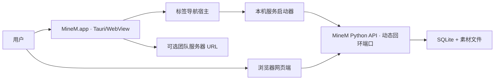
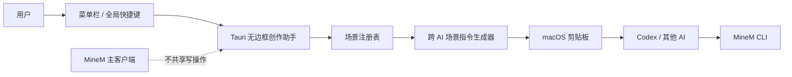

# MineM macOS 客户端技术设计

> 状态：已确认并实施。包含“页面链接复制”“页面刷新”和“MineM 创作助手”技术设计。
>
> 本文记录当前已实施基线。下一版本的一体化运行时、首次初始化、CLI/MCP/API 与资源包方案见 [MineM 本地 AI 客户端技术设计](MineM_LOCAL_AI_CLIENT_TECHNICAL.md)。

## 目标

在不改变现有网页端和素材生成链路的前提下，提供可安装的 macOS 客户端。用户可以继续用浏览器访问 MineM，也可以双击客户端打开同一套平台。

## 使用方式

| 场景 | 入口 | 服务位置 | 数据位置 |
| --- | --- | --- | --- |
| 网页端 | 浏览器访问平台 URL | 本机或团队服务器 | 服务端工作目录 |
| 本机客户端 | `MineM.app` | 客户端自动启动本机服务 | `~/Library/Application Support/MineM/` |
| 团队客户端 | `MineM.app` 连接团队 URL | 团队服务器 | 团队服务器 |

客户端默认使用本机模式；Tauri 先显示本地启动页，再在后台启动服务。服务优先使用 `8790`，冲突时选择动态回环端口，并通过运行时清单提供给 WebView 与 CLI。客户端不再要求用户手动启动 Docker、Python 或浏览器。

同一台 Mac 上，客户端窗口与浏览器必须访问 `runtime/service.json` 发布的同一个本机服务，并共同使用 `~/Library/Application Support/MineM/` 作为唯一运行数据目录。浏览器不是第二套数据源；任一入口完成导入、修改、编排或删除后，另一入口刷新即可看到结果。仓库目录中的历史开发数据只能通过受控迁移脚本合并到该目录，禁止同时运行两份 SQLite 素材库。

## 架构



- 前端：继续复用 React 构建产物，不复制页面和交互代码。
- 客户端壳：Tauri 2，使用 macOS 系统 WebView，降低 Electron 的体积与内存占用。
- 本机服务：以 PyInstaller onedir 目录随应用安装，监听 `127.0.0.1` 动态可用端口；避免单文件每次启动解压。
- 数据隔离：客户端通过 `MINEM_DATA_DIR` 指向用户目录，不能写入 `.app` 安装包，也不与 Docker 的工作目录共享 SQLite。
- 网页端兼容：网页端仍通过 API 访问，所有导入、素材、故事线和预览能力保持原有调用方式。

## 启动与恢复

1. 单实例插件最先运行；重复启动只显示并聚焦已存在的主窗口。macOS Dock 的
   `RunEvent::Reopen` 使用同一恢复路径，先取消最小化，再显示并聚焦主窗口。
2. 客户端立即创建主窗口并显示本地启动页，服务初始化在后台线程执行。
3. 只复用版本、数据目录和托管标识均匹配，并且进程组仍可验证的健康实例。
4. 若运行时清单指向健康的旧版本客户端托管服务，先终止清单记录的进程组并确认端口释放，再启动当前版本；接管失败立即中止，不并发启动第二个服务。
5. 失效的托管清单自动标记停止；Docker、开发服务和其他非客户端托管进程不复用、不终止。
6. 没有可用服务时启动目录式 `minem-server`，传入数据目录、动态端口、父进程 PID 和关闭自动扫描。
7. `/api/version` 返回 MineM 产品标识后，原窗口导航到真实服务地址，不重新创建窗口。
8. 关闭主窗口只隐藏到托盘；托盘“退出 MineM”统一终止 Sidecar 进程组。客户端异常消失时，服务端父进程监控主动关闭。
9. 子进程退出或健康检查超时时读取当前错误日志末尾，启动页显示可操作的真实原因；日志内容限制长度，不能阻塞界面。

## 导航宿主

### 链接拦截与路由

1. 客户端创建固定主页标签，并用一个独立 WebView 承载每个内容标签。
2. `on_navigation`、新窗口请求和 `window.open` 都统一进入原生路由层。
3. 与当前本机服务基址相同的 URL，或与用户显式配置的团队服务域名相同的 URL，在客户端新标签中打开。
4. 其他 `https` URL 调用 macOS `open` 交给默认浏览器；`file:`、自定义协议和危险跳转一律拒绝并记录日志。
5. 标签状态包含标题、URL、加载中与关闭能力；本期不提供后退、前进、刷新或可编辑地址栏。

为避免 macOS WebKit 对 `target="_blank"` 与 `window.open` 的事件回调差异，客户端在每个 MineM WebView 注入轻量链接桥接脚本：将新开页请求转为同源的临时导航地址，原生 `on_navigation` 拦截该地址、创建标签并取消当前页导航。该桥接不修改 React 页面代码，不影响网页端行为。

### 页面链接复制

- React 复用统一的 `copyCurrentPageLink` 操作，优先使用 `navigator.clipboard.writeText(window.location.href)`。
- 浏览器权限或 WebView 剪贴板不可用时，使用隐藏文本域与 `document.execCommand("copy")` 作为回退。
- 仅在素材详情、预览和其他可独立打开的页面头部右上角渲染图标按钮；按钮使用现有图标库并提供无障碍标签与悬浮提示。
- 复制操作不请求后端、不触发素材更新，也不影响预览加载。

### 页面刷新

- 在同一页面操作区提供刷新图标，使用 `window.location.reload()` 重新加载当前 URL。
- 刷新前端详情页时重新请求详情和预览数据；刷新独立预览页时重新请求 HTML 与其资源，从而读取替换后的生成结果。
- 刷新仅重新读取内容，不调用导入、生成、去重或数据写入接口。

### 窗口模型

- 简化标签栏由 Tauri 原生窗口承载，网页端只负责 MineM 业务界面，避免修改现有 React 路由和页面布局。
- 多标签页复用同一应用窗口，不为每次“打开链接”创建独立 macOS 窗口。
- 关闭内容标签仅销毁对应 WebView；主页标签始终可回到素材库。

## MineM 创作助手

### 架构边界



- 在 Tauri 原生层使用独立 `WebviewWindow`，标签为 `quick-actions`；窗口默认 `alwaysOnTop`、`decorations: false`，以右侧抽屉形态复用同一 WebView，失焦保持显示。
- 助手 UI 使用独立静态前端入口和纯 JavaScript 核心模块，不加载主素材库 React 应用，不请求列表、缩略图或导入任务接口，因此不增加平台首屏网络请求。
- 原生壳按职责拆分为 `desktop_runtime`、`navigation`、`quick_actions` 和 `native_bridge`；`main.rs` 只负责插件注册、命令装配和应用生命周期，禁止继续堆叠窗口、剪贴板、CLI 或 Sidecar 细节。
- 原生层通过官方 `tauri-plugin-global-shortcut` 注册 `Option + Command + M`，并同时注册 `Control + Option + M` 作为 macOS 原生“最小化全部窗口”或前台应用抢占主快捷键时的备用键；菜单栏入口继续作为可见回退。客户端内的模式与复制快捷键只在助手获得焦点时生效。
- 外部自动化可使用 `MineM --args --assistant`、`--creator-assistant` 或 `minem://assistant` 唤起助手；单实例已运行时直接展开既有抽屉，不启动第二个 Sidecar。
- 初始化首次达到 `ready` 后自动显示一次助手，并在应用数据目录写入引导完成标记；后续启动不自动显示，继续由主快捷键、备用快捷键或菜单栏唤醒。
- 助手不读取主客户端当前页面、系统剪贴板历史、其他应用或浏览器历史；只允许在复制后立即回读本次写入文本，用于阻止假成功。
- 助手只调用受限 Tauri command：写入并复核剪贴板、发现或修复 CLI、切换抽屉展开状态和隐藏窗口。不得调用 MineM 写 API、通用文件读取 API 或数据库。
- `tauri.conf.json` 必须开启 `app.withGlobalTauri`，否则静态浮窗无法获得 `invoke`，关闭、CLI 检查和安装按钮都会退化为无响应。
- 抽屉顶部空白区声明原生 drag region，按钮区域不参与拖动；收起图标使用移动阈值区分点击展开与拖动。顶部不展示快捷键文字，只提供收起和关闭两个图标按钮。
- 展开内容使用单层白色工具面板、三段场景切换和无外框分隔列表；不渲染业务输入、上下文栏、模板或命令预览。收起状态只渲染圆形 MineM 图标，不保留方形底板、透明表单或额外白色区域。

### CLI 门禁状态机

1. 客户端启动时原生层自动生成或刷新 `~/.local/bin/minem`；WebView 初始化后调用 `cli_tool_path`，按用户入口、Homebrew 和历史系统入口的顺序发现可执行文件。
2. 未就绪时显示 `cli-required` 状态，只保留标题栏、安装按钮和状态信息；操作工作区设置为隐藏且不可聚焦。
3. 用户点击修复后调用异步 `install_cli_tool` 写入当前用户目录，不请求管理员授权，不阻塞 WebView 主线程；失败时保留门禁并展示可重试错误。
4. 安装成功后返回 CLI 绝对路径并进入 `ready` 状态；该路径只用于客户端就绪检查，命令生成器统一复制稳定命令名 `minem`。
5. 收起、关闭和 `Esc` 由原生窗口命令处理，不受 CLI 门禁状态影响；`Esc` 执行关闭，失焦不自动隐藏。

### macOS 窗口适配

- Tauri 窗口尺寸使用逻辑点，WebView 内不设置 `zoom`，由 WKWebView 处理 Retina scale factor。
- 原生层用同一尺寸函数处理两种状态：展开态 `420×clamp(workAreaHeight-24, 480, 520)`，收起态 `48×48`；工作区不足 480 点时使用真实可用高度。首次创建按物理像素贴右并垂直居中，后续切换尺寸保留用户拖动后的右边缘与垂直中心锚点并夹紧到工作区。
- 创作助手 Webview 同时启用 Tauri `app.macOSPrivateApi` 与 `macos-private-api` 构建特性，使用透明原生窗口并关闭系统矩形阴影；展开态边界与阴影由 CSS 面板绘制，收起态只允许圆形品牌图标像素可见。
- `quick_actions::show` 总是切换到展开态并重新定位；`set_collapsed(true)` 收为图标；`hide` 完全隐藏。
- 每次状态变化优先使用窗口当前显示器，无法获得时回退主显示器。外接屏断开后再次唤起会重新定位，不沿用失效坐标。
- 无边框窗口保留自绘收起和关闭按钮，不叠加 macOS 系统交通灯；点击区域按逻辑点计算，适配不同 DPR。

### 应用图标

- 使用 `desktop/src-tauri/icons/icon-source.svg` 生成 macOS 标准图标集和 `icon.icns`。
- Tauri bundle 显式声明图标清单；构建产物的 `Info.plist` 必须存在 `CFBundleIconFile`，应用包资源目录必须存在对应 `.icns`。
- 发布冒烟检查覆盖 Finder、Dock、应用切换器和菜单栏，防止源码有图标但安装包仍显示通用占位图标。

### 指令模型与校验

```ts
type CreatorMode = "report" | "page" | "case";

type ScenarioId =
  | "import_report"
  | "create_report"
  | "insert_page"
  | "replace_page"
  | "modify_report_page"
  | "import_page"
  | "create_page"
  | "duplicate_page"
  | "modify_page"
  | "extract_case"
  | "insert_case";

type ScenarioDefinition = {
  mode: CreatorMode;
  label: string;
  description: string;
  icon: string;
  skill: "minem-report-workflow" | "minem-html-page" | "minem-case-material";
  inputs: string[];
  constraint: string;
};
```

- `SCENARIO_META` 是唯一场景注册表。UI 只按 `mode` 过滤并渲染列表；新增场景不复制表单、校验或事件代码。
- 每个场景固定绑定一个仓库 Skill；完整工作流、分类、版本、幂等和验收规则只在 Skill 中维护。
- `buildScenarioInstruction` 只接收场景 ID，不接收本机 CLI 路径或用户业务字段；输出固定 Skill、2–3 个空白信息项、一个关键约束和结果要求。
- 空白项保留在复制文本中，用户可在 AI 输入框直接粘贴附件路径、链接、编号和要求；AI 只追问仍缺失的信息。
- 复制模板统一假设 MineM 客户端与 `minem` CLI 已安装，当前 AI 产品能够读取对应 MineM Skill；模板不内嵌绝对路径、诊断命令、能力清单或完整执行协议。
- 指令复制由原生 `clipboard_write` 使用 AppKit `NSPasteboard` 写入 macOS 通用剪贴板；写入后立即从同一 Pasteboard 回读，并在统一换行后比较完整内容。WebView 回退链路也必须调用原生读接口完成相同校验。只有系统剪贴板真实保存完整指令才显示成功，失败时释放复制锁并恢复列表。
- Web 平台顶部“创作”入口调用本机服务的 `POST /api/desktop/creator-assistant`。客户端启动服务时会将当前 MineM.app 的真实可执行路径传入 `MINEM_DESKTOP_EXECUTABLE`；服务据此传入 `--assistant`，客户端单实例插件负责展开现有抽屉。该路径不假设应用必须位于 `/Applications`，因此从下载目录、挂载镜像或企业管理目录启动后，关闭助手仍可再次由平台唤起。未检测到客户端时返回明确错误，不在网页端复制一套助手实现。
- 浮窗不使用 `localStorage` 保存业务草稿或自定义模板，不读取附件、链接、编号或剪贴板内容。
- 后续如需“在浮窗直接执行”，必须另开需求，增加预览、确认弹窗、幂等请求键和 MineM API 权限范围；不复用本期复制功能直接写库。

### 构建与测试

- 浮窗前端与主客户端壳一同纳入 `npm run desktop:build`，但不影响网页端构建产物和 Python 服务侧车。
- 自动测试覆盖：三组场景集合、固定技能、可填写空白项、关键分类与版本约束、短模板长度、无机器绝对路径、无输入 DOM、抽屉布局、复制超时、原生启动重试和 `--assistant` 唤醒。
- 手工 macOS 测试覆盖：多显示器、全屏主窗口、剪贴板权限拒绝、快捷键冲突、全部场景逐项复制、连续点击、成功 Toast、失败恢复，以及 TextEdit/Codex 等外部应用的真实粘贴结果。
- Dock 恢复测试覆盖关闭到托盘和最小化两种状态：再次点击运行中的 MineM 图标，
  原主窗口应显示并获得焦点，窗口数量和 Sidecar 进程数量都不增加。

## 构建与发布同步

### 何时必须重打包

| 变更范围 | 是否重打包 | 原因 |
| --- | --- | --- |
| `frontend/`、`public/` | 是 | 客户端内嵌前端构建产物 |
| `server.py`、`minem/`、`templates/` | 是 | 需重新生成 PyInstaller 本机服务侧车 |
| `desktop/` | 是 | 原生壳、签名或安装逻辑变化；正式 `npm run build` 会先重建最新 Sidecar，避免 CLI/后端与客户端版本错配 |
| 用户数据、SQLite、上传素材 | 否 | 数据位于 Application Support，不属于程序包 |
| Docker 配置 | 仅影响 Docker 发布 | 本机客户端不依赖 Docker |

### 发布命令

`npm run desktop:build` 必须依次完成：

1. 生成 React 前端构建产物。
2. 使用 PyInstaller onedir 生成并原子替换 `sidecar/` 运行目录。
3. 构建 Tauri `.app`。
4. 对最终 `.app` 及其侧车执行 ad-hoc 签名校验。
5. 生成 `.dmg`。

用户以新 `.dmg` 覆盖安装旧版；不迁移、不删除 `~/Library/Application Support/MineM/`。

## 打包边界

- `.dmg` 只包含应用、前端构建产物和服务运行时，不包含 `data/`、`uploads/`、`extracted/`、`thumbnails/` 或本地语音模型。
- 用户素材和 SQLite 一律留在 Application Support，升级客户端不会覆盖。
- Docker 仍保留给开发、测试和部署场景。客户端本机服务不会与同一数据目录上的 Docker 实例同时运行。

## 发布步骤

1. 构建 React 前端：`npm run build`。
2. 使用 PyInstaller 构建 `minem-server`，并把 `public/`、`templates/`、`minem/` 等运行依赖带入服务包。
3. 使用 `npm run desktop:build` 生成包含前端、侧车和 ad-hoc 签名的 `MineM.app` 与 `.dmg`。
4. 在干净 macOS 账户验证首次启动、导入、预览和升级后数据保留。

### 本机构建前置条件

- 安装 Xcode Command Line Tools，并接受 Xcode 许可；PyInstaller 在处理 macOS 动态库时会调用 `install_name_tool`。
- 安装 Rust stable 工具链和 Cargo，用于编译 Tauri 客户端。
- 安装桌面端 Node 依赖与 `desktop/requirements-build.txt` 中的 PyInstaller。
- 未接受 Xcode 许可时，客户端源代码与前端可校验，但 `.dmg` 侧车打包会被系统拒绝。

## 验收标准

- 用户无需安装 Docker、Python 或 Chrome，即可双击打开 MineM。
- 浏览器端和客户端显示同一套界面与数据。
- 客户端重新打开后仍能看到本地素材、故事线和历史版本。
- 客户端运行时不监听局域网地址，不暴露本机素材服务。
- 服务启动失败时客户端提供明确错误与重试入口，而不是空白页面。
- MineM 内部“打开链接”和新窗口请求能直接在客户端新标签中正确打开，标签可关闭；外部链接由系统浏览器处理。
